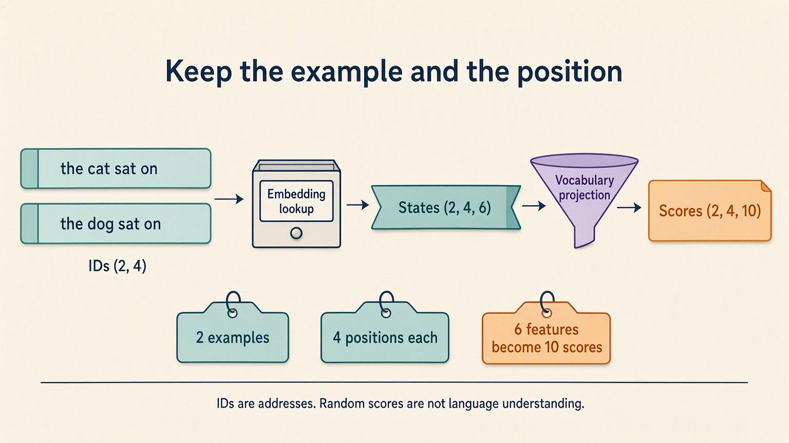

# Tensors and Autograd: Handwritten Theory

The sensor guesser learned, but its numbers still need addresses. Which example
does a value belong to? Which feature? If we hand the same loop a sentence,
which word position?

Borrow two familiar strips: **“the cat sat on”** and **“the dog sat on”**.
Unlike the sensor table, each example now has positions inside it. That extra
axis makes losing or swapping roles visible. We deliberately return to sensor
rows in Part 03, where ownership—not language learning—is the new problem.

Each word gets an integer ID, an address into a ten-row table. A lookup fetches
a six-feature row at each position; a projection makes ten candidate scores.
These are random numbers, not useful word meanings. The later
[word lessons](../../03-language-model-foundations/02-tokenization-and-embeddings/README.md)
choose text pieces and train their rows with meaningful checking answers.

The local IDs are `[0,1,2,3]` and `[0,4,2,3]`. There are eight input
addresses, not ten-number input vectors. ID 0 fetches stored row 0,
not zeros. The early shape exercises create random states directly;
they don't perform lookup until the closing wiring experiment.



## 1. A shape is an address system

A tensor is not difficult because it has many numbers. It is difficult when the axes lose their
names.

Use this mental model:

> A shape tells you how to address a value; axis names tell you what that address means.

For language-model data:

```text
token IDs       (batch, time)
hidden states   (batch, time, feature)
logits          (batch, time, vocabulary)
```

Shape says how values are grouped, dtype says what kind of number is stored,
and device says where it lives. Token IDs are integer addresses. Hidden states
are floating-point values. Compatible shapes don't repair a wrong dtype or a
CPU/GPU mismatch.

**Complaint:** printing values does not reveal whether an axis was preserved.

## 2. Indexing can silently remove an axis

An integer index chooses one coordinate and removes that axis:

```text
states[0]    (batch, time, feature) -> (time, feature)
```

A slice preserves the axis:

```text
states[0:1]  (batch, time, feature) -> (1, time, feature)
```

The values can look identical while the downstream contracts differ. Use an integer when you
intend to remove an axis. Use a slice when you still need a one-example batch.

**Complaint:** preserving the number of values does not preserve their interpretation.

## 3. Reshape and transpose solve different problems

Reshape groups the same ordered values under a new address system. Transpose moves axes.

Splitting a model feature axis into attention heads uses both operations:

```text
(batch, time, feature)
-> reshape
(batch, time, head, width)
-> transpose
(batch, head, time, width)
```

The notebook performs the reverse operations and proves exact value recovery. That round trip
shows value preservation. It does not prove that arbitrary axis names are meaningful; meaning is
still the programmer's job.

## 4. Broadcasting is aligned repetition

Broadcasting aligns shapes from the trailing dimensions.

A feature bias shaped `(feature,)` can be reused across `(batch, time, feature)`. A time bias
shaped `(time,)` collides with the feature axis. Reshaping it to `(1, time, 1)` states the intended
repetition across batch and feature.

In the actual exercise, feature index 4 receives +4 at every position;
position index 2 receives +2 across all six features. Those are different
jobs even though both offsets arrive as short lists. The `[1,4,1]` shape
states which role varies instead of relying on lucky dimension sizes.

The framework's error is useful evidence. It proves the original trailing dimensions were
incompatible. The repair is not "add dimensions until it runs." The repair is to name the missing
axes.

**Complaint:** element-wise operations preserve axes; a model also needs to mix information across
an axis.

## 5. Matrix multiplication contracts one axis

For each text position, combine its feature values into one raw score per possible text piece. The feature entries are summed away, while the example and position stay separate. This is what contracting the feature axis means. Here **LM** means language model; the operation below checks its shapes, not its ability to predict text.

For an LM vocabulary projection:

```text
states @ W_vocab
(batch, time, feature) @ (feature, vocabulary)
-> (batch, time, vocabulary)
```

The matching feature dimensions are consumed by dot products. Batch and time survive. Vocabulary
appears as the new output role.

Element-wise multiplication asks, "How should each coordinate be scaled?" Matrix multiplication
asks, "How should coordinates combine into new coordinates?"

## 6. Autograd records influence

Autograd records operations that connect tensors requiring gradients to a final scalar.

For a simple chain, the notebook compares `.grad` with a manually calculated derivative. The
agreement is evidence that the graph followed the same local sensitivities.
In the small audit, the weight feedback is thirty and the offset feedback is
ten. Backward writes those values without performing an optimizer update.

Gradients accumulate because several paths or mini-batches may legitimately contribute to one
parameter. Clearing is therefore explicit. `detach()` creates a tensor that shares values but
leaves the graph. `inference_mode()` disables graph construction for an inference region.
The separate notepad experiment measures three after one backward and six after
two. It builds a fresh graph each time; retained gradient values and a retained
computation graph are different things.

Autograd knows influence, not intent. It can correctly differentiate the wrong objective or a
silently misnamed axis.

## 7. The language-model-shaped bridge

Embedding lookup preserves batch and time and appends a feature axis. The vocabulary projection
contracts feature and appends vocabulary. Backpropagation produces gradients shaped like the
embedding table and output projection parameters.

This is the same mechanism used in a large language model, reduced to inspectable dimensions.

Count the roles: the embedding stores 60 parameters in `[10,6]`; these
eight IDs fetch 48 activations in `[2,4,6]`. The output layer stores
another 60 parameters as `[10,6]` and returns 80 scores in `[2,4,10]`.
Its stored orientation differs from the earlier `[6,10]` matrix notation,
not from the intended six-input-to-ten-output calculation.

The squared-score loss supplies no checking word, and there is no
optimizer step. Backward reaching both tables proves wiring, not language
learning. That small limit matters more than the familiar-looking shapes.

## Practical failure modes

- Writing shapes without axis names.
- Accidentally removing the batch axis.
- Using reshape as a mystery repair.
- Treating floating-point values as token IDs.
- Confusing element-wise and matrix multiplication.
- Forgetting that gradients accumulate.
- Assuming a differentiable graph is automatically a sensible model.

**Durable summary:** tensor code becomes readable when every operation can be narrated as
selecting, regrouping, moving, repeating, or contracting named axes.


The preview's squared-score loss only checks gradient wiring. It does not train a useful text predictor.
Next, [Models and Training Loops](../03-models-and-training-loops/03-models-and-training-loops.ipynb)
returns to two sensor columns and one fuel target. Dropping the position axis keeps the comparison
of raw tensors and modules simple: who owns the weights, and how do they survive a fresh process?
