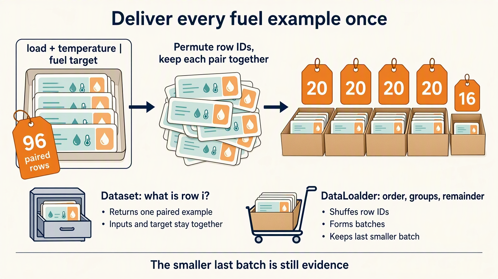

# Data, Checkpoints, and Hyperparameters: Handwritten Theory

## 1. Batching is an experiment policy

Keep the fuel task from Part 03: engine load and ambient temperature belong
together in one input envelope, and one fuel target belongs to that same
envelope. Reload its saved model in a fresh kernel before changing delivery.
If the files are missing, run Part 03; silently inventing replacement weights
would erase the handoff we are trying to test.

Full-batch training uses every example for every update. Mini-batch training changes which
examples contribute together and how often updates occur.

Start manually:

```text
make a permutation
-> slice index groups
-> retain or drop the remainder deliberately
-> use each group for one update
```

The notebook proves that the manual groups cover every example exactly once. This matters because
a list of plausible batch sizes can still duplicate or omit examples.

There are 96 envelopes. Twenty per box gives four boxes of twenty and one of
sixteen. Joining and sorting their addresses matches the original address list.
That proves coverage, while a mere total of 96 could conceal duplicates.



**Complaint:** manual index logic mixes data access, ordering, and grouping.

## 2. Dataset and DataLoader separate two contracts

`Dataset` answers:

> What is example `i`?

`DataLoader` answers:

> In what order, in what group size, and with what remainder policy should examples arrive?

That separation becomes valuable when storage changes but training code should not. The notebook
uses `TensorDataset`, then verifies an ordered loader reconstructs the original features and
targets exactly.

Shuffle is not a property of the underlying examples. It is a policy for an iteration. For a fair
comparison, seed that policy or record it.

The ordered-loader audit joins feature batches along their existing example
axis and does the same for targets. Both reconstructed tables must match their
originals. A new stack axis would answer a different question. Peeking at a
shuffled loader also consumes iteration state; a dedicated random generator
does not automatically freeze the next delivery.

## 3. A model state dictionary serves inference

`model.state_dict()` contains learned parameter and buffer tensors.

A prediction-parity check is the practical contract:

```text
prediction before save
== prediction after fresh model + load
```

The notebook reloads Part 03 in a fresh kernel and asserts zero prediction difference for the
probe. That is stronger evidence than checking that the file exists.

The two separately reconstructed models receive the same seven input rows.
We compare the largest absolute gap, so an average cannot hide one
changed prediction. Compatibility checks also confirm two input features and
one output. A shape-compatible file with a different feature order would still
be wrong, so the sensor names remain part of the contract.

The test compares two reconstructions from the saved file, not a live
object from Part 03. It checks usable saved predictions, not original
training-loss equality. Part 04 makes noise on CPU while Part 03 used
its selected device, so cross-device runs should not assume the noisy
targets are bit-identical merely because the seed matches.

**Complaint:** weight parity is enough for inference, but not enough to continue training.

## 4. A training-state snapshot saves more than weights

Use the travel-bag mental model:

- **model state** is the learned function;
- **optimizer state** is how the updater was moving;
- **epoch** is where the process stopped;
- **configuration** explains the policy that created the state.

Adam's moving averages affect its next update. Loading only model weights and creating a new Adam
optimizer changes the continuation, even if the first reloaded prediction is identical.

A scheduler, scaler, sampler, or stopping counter may need saving too. The useful question is
simple: will the same batch produce the same next update?

This notebook checks matching predictions after weight reload and writes a training-state
snapshot. It does not reload that snapshot or compare against uninterrupted training.
The shuffled loader's random state is missing. We keep the existing `part04_resumable.pt`
filename for compatibility; its name does not add a recovery test.

The snapshot loop trains a fresh model for 25 epochs. Five batches per
epoch mean **125 updates**. Its saved epoch is 24 because indexing starts
at zero; the progress message reports 25 completed passes. Neither count
is a parameter learned by the prediction model.

Variable-length sequences add another batching complaint: rows must fit a rectangle without pretending that blank slots are real observations. Filling those slots is **padding**; keeping each row's true **length** tells you where the content ends. Stage 03 applies that contract to text and distinguishes which blanks must not be read from which blanks must not be graded.

Those two jobs need separate masks: an input/attention mask limits what
the model may read, while a loss mask selects targets to grade. Ignoring
a blank target doesn't by itself prevent padded inputs influencing a
prediction. The fixed-width fuel rows don't need that machinery yet.

## 5. Configuration is not learned state

The model does not learn batch size or learning rate as parameters in this experiment. Those
values belong to the experiment configuration.

Separating configuration from state makes two questions answerable:

1. Can I reconstruct the learned function?
2. Can I explain and continue the process that produced it?

Conflating the two usually leads to brittle checkpoints or undocumented defaults.

## 6. Hyperparameters require controlled comparisons

A hyperparameter comparison is evidence only when other conditions remain fixed.

For learning rate:

```text
same seed
same initial model
same data
same loss
same update count
different learning rate
```

The notebook prints the initial and final loss for each candidate. A larger rate can move faster,
overshoot, or diverge. There is no useful conclusion from changing learning rate, batch size, and
model width at the same time.

Validation data should choose among settings. Test data should remain untouched until choices are
finished.

## 7. The LLM bridge

Language-model data pipelines add tokenization, sequence packing, padding, masks, and distributed
sampling. The same contracts remain:

- an item has named shapes and dtypes;
- a loader owns ordering and grouping;
- remainder behavior is explicit;
- checkpoints distinguish inference state from continuation state;
- comparisons change one policy at a time.

## Practical failure modes

- Dropping the last partial batch without noticing.
- Comparing shuffled runs with different random order and calling the result causal.
- Loading state into a different architecture.
- Saving optimizer state but omitting scheduler or progress state.
- Tuning on test data.
- Naming a checkpoint "resume" without testing a real continuation.

**Durable summary:** data loading and checkpointing are not plumbing; they are contracts about
which evidence arrives, in what order, and which state survives interruption.


**Next complaint:** correct batches and saved state do not stop validation from accidentally changing the model. [The Modern Training Lifecycle](../05-modern-training-lifecycle/05-modern-training-lifecycle.ipynb) separates learning, measurement, model selection, and interruption state.
