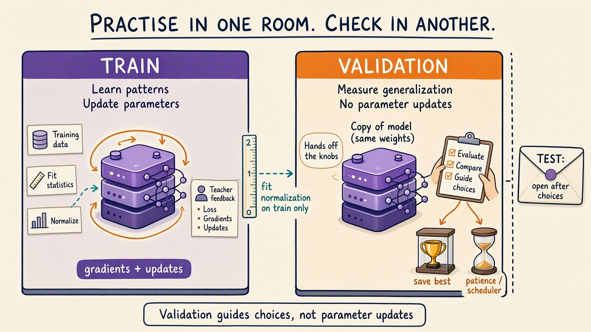

# The Modern Training Lifecycle: Handwritten Theory

Keep the two sensor columns and fuel target from Parts 03–04. A curved interaction now gives a
small nonlinear model something to learn; the new focus is separating training from validation.

## 1. Split before preprocessing

Validation and test sets exist to simulate future evidence. If their feature distribution helps
choose normalization statistics, they have already influenced training.

The correct order is:

```text
raw rows
-> train/validation/test split
-> fit mean and scale on train only
-> apply those train statistics everywhere
```

The notebook measures that train-only and all-data means differ. That difference is the leaked
information an all-data normalizer would import.

There are 108 training rows, 36 validation rows, and 36 test rows.
The training-derived feature and target rulers are fitted state, not
neural-network parameters. Validation uses those same rulers; fitting
a fresh zero and scale on each split would change what its coordinates mean.

**Complaint:** honest splits still fail if validation accidentally behaves like training.

## 2. Train and validation loops have different responsibilities

The training loop:

- selects training mode;
- constructs gradient graphs;
- clears gradients;
- backpropagates;
- updates parameters.

The validation loop:

- selects evaluation mode;
- constructs no gradient graph;
- measures without updating.

These are not cosmetic differences. Dropout produces different repeated outputs in training mode
and identical repeated outputs in evaluation mode. The notebook measures both behaviors on the
same input.

The model owns 65 parameters, but dropout owns none. Its 0.15 drop
probability temporarily masks hidden **activations**, not stored weights.
Changing mode therefore changes the calculation's behavior without
loading a different parameter set.

Think of practice and the exam as different rooms. In the practice room the
knobs can move. In the exam room hands stay off the knobs; the score can guide
later decisions, but this pass cannot adjust parameters.



The notebook also copies weights and any existing gradient buffers around an
evaluation call and asserts that both remain unchanged. An old training
gradient may still be present after evaluation; its presence alone does not
mean validation wrote it. Compare state before and after.

## 3. Average losses with batch size in mind

If the final batch is smaller, averaging batch means equally gives that smaller batch too much
weight.

The readable pattern is:

```text
sum(batch loss * batch size)
divide by total examples
```

This preserves the per-example mean across uneven batch sizes.

At batch size 24, validation delivers 24 rows then 12. If their mean
losses were 1 and 4, the example-weighted mean would be 2; averaging the
two batch means would incorrectly give 2.5. These are arithmetic examples,
not reported validation losses. Training similarly keeps a 12-row
remainder after four full batches.

Training and validation scores still have different conditions: training
uses dropout while weights change between batches; validation uses fixed
end-of-epoch weights in evaluation mode. A gap between the curves is not
automatically evidence of a broken loop.

## 4. Schedulers and mixed precision are conditional tools

A scheduler changes the learning rate according to measured progress. In the notebook,
validation loss drives a plateau scheduler. The recorded learning-rate history is evidence of
its decisions.

If suitable GPU operations use fewer digits while other operations retain more, that is **mixed precision**. A **scaler** temporarily enlarges the loss and compensates before updating, helping very small gradients remain representable. This is an implementation option, not a new learning objective.

Mixed precision can improve accelerator throughput and memory use. It is enabled only on CUDA in
this teaching run. That boundary is honest: CPU execution does not pretend to demonstrate an
accelerator payoff.

Neither tool repairs a wrong loss, leaked split, or broken shape contract.

## 5. Early stopping is a validation state machine

Use this mental model: early stopping is a patient observer, not a trainer.

It tracks:

- the best validation value seen;
- the number of consecutive non-improving checks;
- the patience limit.

It should not watch training loss because training loss often keeps improving while
generalization worsens.

The stopping rule and the best-model rule are related but different:

- stop when patience is exhausted;
- keep the state from the best validation epoch.

The last epoch is not automatically the best epoch.

The supplied stopping-rule drill improves from 1.0 to 0.8 at check 2,
then gets 0.81, 0.82, 0.83, 0.84. Patience four stops at check six.
Those numbers test a decision rule; they aren't invented training history.
The scheduler's patience three and the stopping observer's patience ten
are separate counters with separate decisions.

## 6. Best-model files and training-state snapshots serve different jobs

A best-model checkpoint supports inference. It needs:

- model state;
- preprocessing state;
- architecture/configuration facts required for reconstruction.

Continuing the same training run needs more than inference weights:

- optimizer state;
- scheduler state;
- current epoch;
- early-stopping state;
- mixed-precision scaler state when enabled;
- any sampler or accumulation progress that affects the next update.

The notebook reloads the best model for test inference. The separate training-state snapshot
gets a key check, not a recovery test. It leaves out the scaler, shuffled-loader and dropout
random states, and preprocessing statistics. We keep the existing `resume_training.pt` filename
for compatibility.

Saving weights plus optimizer state does not prove a matching next update. To check that,
restore everything that affects the next batch and update, then compare with uninterrupted training.

## 7. Return predictions to original units

Training on normalized targets can improve optimization, but stakeholders do not consume
normalized fuel scores.

The inference path must reverse target normalization:

```text
normalized prediction
-> multiply by training target scale
-> add training target mean
-> report original units
```

Preprocessing state is therefore part of the deployed prediction contract.

The fresh best-model reload reconstructs test features using the rulers read
from the file, rather than borrowing a live normalized array. That small
distinction tests the artifact's contract. It then reverses the saved target
normalization and reports absolute misses in the original synthetic fuel
units. None of those units turns the generated dataset into a real engine test.

## 8. Automation comes after visible responsibilities

Lightning can map the manual pieces into hooks and callbacks. `torch.compile` can optimize a
correct graph. These tools reduce boilerplate; they do not remove the need to understand:

- split integrity;
- mode changes;
- gradient boundaries;
- checkpoint contents;
- metric units.

## Practical failure modes

- Normalizing before splitting.
- Validating in training mode.
- Updating parameters on validation batches.
- Early-stopping on training loss.
- Treating the last epoch as the best model.
- Omitting preprocessing state from inference artifacts.
- Calling a weight-only file resumable.
- Enabling advanced performance tools before correctness is measured.

**Durable summary:** a modern trainer automates lifecycle code, but correctness still depends on
visible evidence boundaries, mode boundaries, and state boundaries.


**Next complaint:** the fuel model sees independent rows, not an ordered history. [Sequence Memory](../../03-language-model-foundations/01-sequence-memory/README.md) reuses this training lifecycle while adding a state that carries information from earlier steps. No fuel artifact is needed there; carry the contracts, not the dataset.
