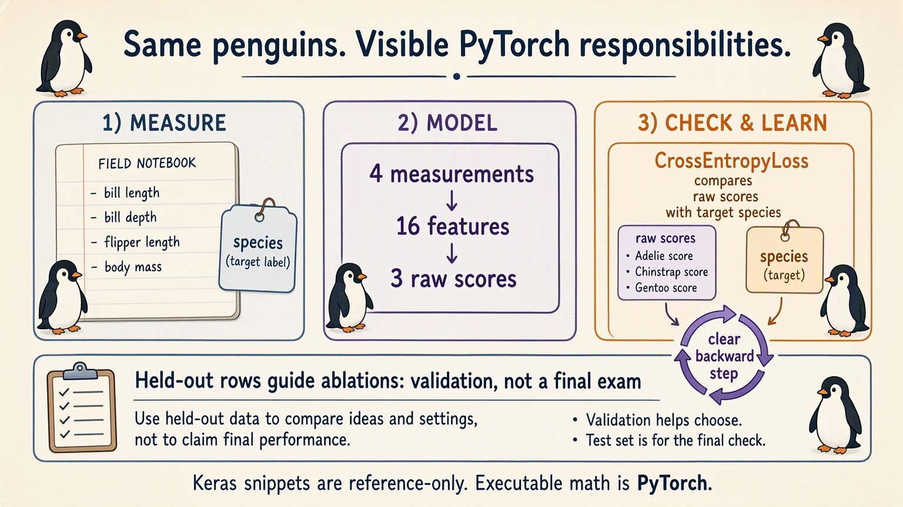

# Antarctic Field Guide: Handwritten Theory

## 1. Translate responsibilities, not neural-network theory

You know Keras, but a short high-level training call can hide who owns data
conversion, gradients, updates, and inference behavior. PyTorch does not add
a new account of learning. It makes those responsibilities visible.

The required route used synthetic sensors to keep mechanisms inspectable.
This optional branch intentionally changes to real Palmer penguin measurements:
bill length, bill depth, flipper length, and body mass predict species.
Physical units, incomplete rows, and uneven species counts expose contracts
that a perfectly tidy toy table can conceal.

The data are bundled in a CC0 package. Keras snippets are reading references;
the executable notebook is PyTorch-only. It does not install TensorFlow or
benchmark the two runtimes.

**Complaint:** a reproducible source does not automatically mean usable
training rows or a reproducible program.

## 2. Keep the evidence and its preparation visible

Seed Python, NumPy, and PyTorch separately because each owns random state.
That repeats the tested recipe, not every possible accelerator's arithmetic.
Print the device so storage placement is explicit.

Discard records missing any required measurement or species label before
splitting. Keep the species answer separate from the four input columns.
Sort species names before assigning IDs so output columns retain stable names.

Inspect class counts and raw scales. Millimeters and grams can have very
different numerical ranges without either measurement being invalid.
The overlaid raw histograms make that scale complaint visible; they are not
a claim that those units describe the same physical quantity.

Split within each species, then fit centers and scales on training birds only.
Reuse that ruler for held-out birds. Letting held-out inputs choose a ruler
would already leak their distribution into the training procedure.

**Complaint:** correctly prepared arrays still need different tensor roles.

## 3. Addresses, measurements, and stored weight orientation

Measurements become floating-point feature rows. Species IDs become long
integers: an ID selects a class, rather than measuring how much species a
bird contains. One label belongs to each input row.

Device and dtype solve different problems. Moving a tensor does not change
an integer label into a useful floating-point feature. Inputs and model
parameters must occupy compatible storage for the operation.

A dense layer combines input contributions and adds one bias per output.
Keras-style notation exposes feature-by-output weights; PyTorch exposes the
output-by-feature transpose. The forward calculation can still be identical.

The notebook briefly uses a smaller three-input, two-output fixed-weight
probe so every coefficient is inspectable. That is an isolated storage test,
not a change to the four-measurement, three-species project.

Its input `[1,2,-1]` gives the first output
`0.20 + 0.70 + 0.25 + 0.05 = 1.20`, and the second
`-0.10 + 0.80 - 0.15 - 0.20 = 0.35`. The exact same coefficients
produce those answers whichever framework's storage orientation you use.
Only the shelf changes, not the contributions reaching each output.

**Complaint:** agreeing forward calculations do not show where gradient
feedback lives or when parameters actually move.

## 4. A graph and a gradient notepad have different lifetimes

First audit one derivative whose answer is known: squaring three gives an
output of nine and a local sensitivity of six. Backward stores six in the
input's gradient field; it does not replace the input with that value.

Then move one adjustable position toward a known target on a number line.
Backward supplies sensitivity, a no-gradient subtraction changes the position,
and clearing removes old feedback before the next pass.

At position -2 with target 5, squared distance is 49 and feedback is -14.
The first rate-0.08 update moves right to -0.88. The plotted path begins
after that update, not at the original -2. This small calculation makes
the sign of the update visible without making up a classifier result.

A fresh forward pass normally constructs a fresh computation graph.
Backward usually releases saved graph intermediates, but leaf gradient values
remain until explicitly cleared. Clearing a notepad and retiring a graph
are therefore different events.

These microscope experiments are not biological predictions. They remove
framework ambiguity before every classifier weight receives the same kind
of feedback.

**Complaint:** a species classifier has competing answers, not one
number-line target. Its checking rule needs raw scores.

## 5. Keep logits raw when the loss expects logits

The project model turns four measurements into sixteen hidden features,
then three species scores. ReLU bends the hidden representation; the last
layer has no probability conversion.

There are 131 parameters across the two layers. Four input birds produce
64 hidden activations and twelve output scores, not new sets of parameters.
The three stable output columns name Adelie, Chinstrap, and Gentoo; integer
labels select among them without becoming physical measurement features.

Cross-entropy consumes raw logits and integer class IDs. Applying softmax
before it still produces an acceptable shape, but those probabilities are
then interpreted as new logits. The notebook's fixed two-class probe measures
different losses and feedback magnitudes for the two routes.

That small probe isolates arithmetic; the project still predicts three species.
Softmax is useful for human-facing relative probabilities after inference,
not as an extra pre-loss operation here.

**Complaint:** a correct model/loss pair still leaves the high-level training
call's hidden work to reconstruct.

## 6. Make one update visible, then repeat it fairly

Clear, predict, measure, backward, step. The optimizer receives registered
parameters; backward fills their gradient fields; Adam changes their values.
A combined gradient norm is an inspection summary, not a replacement for
those individual gradients.

The main function trains from a fixed seed and records actual pre-update
losses and gradient magnitudes. A separate controlled comparison changes
only whether old gradients are cleared.

The clearing comparison uses **45 full-batch updates per model**.
The main classifier uses 160; those budgets should not be confused.
The helper returns the trained model plus pre-update loss and gradient
histories. A gradient norm summarizes feedback; it is not a measurement
of how far Adam moved the weights.

Both comparisons build fresh forward graphs each pass. Without clearing,
old gradient values accumulate and change the path; the experiment is not
about repeatedly traversing one retired graph. Deliberate accumulation can
be valid, but it needs a defined scheme rather than accidental history.

**Complaint:** a decreasing training curve says little about specific
held-out birds or whether confidence deserves trust.

## 7. Audit decisions before using them to choose settings

Evaluation mode selects prediction-time behavior; no-gradient mode avoids
unused graphs. This classifier has no dropout or batch normalization, so
mode declaration does not change its values today.

The confusion matrix separates actual species from predicted species.
Individual records expose confident mistakes that an average can hide.
A large softmax value is a relative preference, not established calibration
or a biological verdict.

Width and feature-set ablations reuse those held-out birds. Once their scores
guide choices, they serve as validation despite historical “test” variable
names. A final quality claim requires another untouched set.

Different widths necessarily change parameter shapes and draws; fairness
means the same split, seed recipe, optimizer, and budget—not identical arrays.
Likewise, restricting features changes what evidence the model can use.

Watch for leaked rulers, floating labels, copied weights without transpose,
double probability conversion, uncleared gradients, and validation called a
final exam.

**Next complaint:** images introduce locality that tabular columns lack.
The [vision branch](../vision/README.md) changes domains for that reason;
the [language route](../../../03-language-model-foundations/01-sequence-memory/README.md)
instead adds ordered memory.

**Remember:** the learning jobs stayed the same; PyTorch made their owners
and boundaries explicit.
