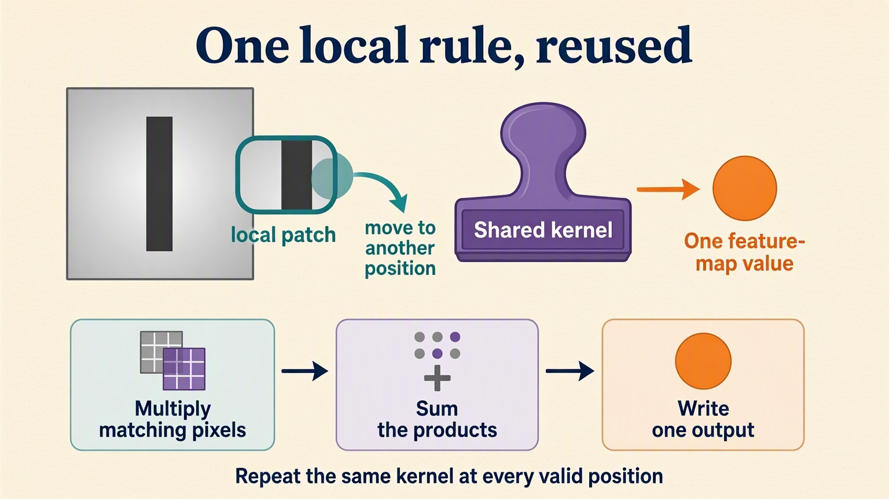

# Shared Visual Filters: Handwritten Theory

## 1. A shifted bar should not require another detector

The sensor lessons used named columns. Images add a different kind of
structure: neighboring pixels form local patterns, and the same pattern
can appear at several positions. A detector trained separately at every
position would repeatedly relearn the same job.

This optional branch changes domains deliberately. Locally generated vertical
and horizontal bars make orientation, shifts, noise, and shared computation
visible. There are no downloaded images or pretrained models.

Each image has one grayscale channel and a sixteen-by-sixteen spatial grid.
Stacking images creates examples; adding the channel axis does not create
another image. Orientation labels remain separate integer answers.

An always-vertical guess gets half the balanced validation examples right.
That crude baseline creates the real complaint: shape-compatible output can
ignore the image entirely.

## 2. One local rule can visit every valid position

A filter is a small reusable table of weights. At one location, multiply
the patch pixels by matching weights and sum the products. That produces
one feature-map value. Move the same filter and repeat.

The notebook first uses a fixed Sobel filter, not a learned one. It detects
changes across the horizontal direction, so vertical edges provide useful
responses. A manually calculated output agrees with PyTorch's corresponding
feature-map value.

The filter's rows are `[-1,0,1]`, `[-2,0,2]`, `[-1,0,1]`. For a clean
three-by-three patch with every row `[0,0,1]`, its response is
`1+2+1=4`. That is a pencil close-up; the noisy validation patch has its
own measured response. A 16-pixel side admits fourteen unpadded positions
for a three-pixel-wide filter, hence a 14×14 map.

Without padding, only positions where the whole patch fits receive outputs.
The response grid is therefore smaller than the image. Weight sharing means
the local rule stays fixed while its location changes; it does not by itself
guarantee that a complete classifier ignores every image translation.

**Complaint:** agreement at one patch does not show the detector's whole-image
behavior.

## 3. Look at the response, then decide what detail to keep

Apply the same filter to a vertical and a horizontal bar. The resulting
maps say where the rule responded, not which class the image must belong to.
Ends, noise, and other edges can produce responses in either image.

Absolute response magnitude avoids cancellation when summarizing opposite
edge directions. Its sum is one total over spatial positions, not an
orientation probability or learned accuracy.

Keeping every nearby patch preserves detail but leaves a large map.
Stride changes where convolution evaluates patches. Pooling instead
summarizes an already computed map, without learning new filter weights.

In the shape probe, stride-two convolution and two-by-two pooling both
produce eight-by-eight maps. Equal shapes do not mean equal values or
interchangeable jobs. Padding is also part of the spatial-size contract.

**Complaint:** hand-picked filters explain arithmetic, but checking answers
should decide which clues the actual classifier needs.

## 4. Learn local clues, then summarize for one decision

The classifier's first convolution makes six feature maps. Pooling shrinks
their spatial grid, and the next convolution mixes local evidence into
ten maps. ReLU adds bends without changing those axis sizes.

Spatial averaging reduces each final map to one number per image.
The final linear layer combines the ten summaries into two raw orientation
scores. It does not treat each map location as another labeled image.

Cross-entropy compares those scores with the orientation ID. The familiar
explicit loop sends feedback through the decision layer and both convolutional
layers, allowing the shared rules to change.

The notebook measures an untrained score and then trained validation accuracy.
Its bounded success is distinguishing new bars from the same local generator,
not recognizing arbitrary real objects.

The recorded training loss is the final batch of each epoch, not an
epoch-wide average. That naming distinction prevents a plausible curve
from claiming a measurement it did not collect.

**Complaint:** a successful class decision still conceals how each learned
rule responds.

## 5. Filters are rules; feature maps are responses

Put each tiny first-layer filter above its response map for the same image.
The weight table and the map have different roles and different spatial sizes.
The first is a local calculation; the second records that calculation
at many locations.

The first learned convolution stores 54 weights and six biases.
Its six 16×16 maps contain 1,536 activations for one image. A new image
can change every response without adding or changing parameters.

Different maps do not automatically establish six named concepts.
A feature may contribute jointly with others, and its visible pattern
is not a complete explanation of the final decision.

A later layer reads earlier maps rather than raw pixels alone.
Its receptive field is the original input region that could affect it.
The notebook traces one second-layer pre-activation backward and marks
pixels with measurable local influence.

The resulting bounding box spans more than one original filter patch.
But a zero gradient under this input does not prove a structural connection
can never contribute. ReLU choices, pooling choices, weights, and threshold
all affect the active local trace.

Architecturally, the first convolution spans three pixels, pooling
extends that to four, and the second convolution can span eight original
pixels away from boundaries. The measured gradient mask is a possibly
sparse active part of that reach, not a new definition of the architecture.

**Complaint:** deeper paths can reach farther while making backward feedback
harder to preserve.

## 6. Let a correction have a bypass

To isolate this issue, briefly replace images with twelve-feature vectors.
Two equal-depth chains receive identical inputs and small transforms.
The residual chain alone adds an unchanged input around each linear-and-tanh
transform.

The bypass is an identity route, while the learned branch supplies a correction.
Addition requires matching feature coordinates. It does not concatenate
features or double the model's output width.

Summing each final vector supplies the same kind of scalar probe.
Comparing input-gradient norms follows the consequence into the backward
route: in this controlled construction, the identity paths preserve a
larger local sensitivity.

That is a measured mechanism, not proof that every residual architecture
will train better on every task. The small-transform construction intentionally
exposes a difficult plain-chain route.

## Before changing the objective

Watch for swapped channel/spatial axes, pooling mistaken for learned filtering,
shape equality mistaken for equivalent operations, and pretty response maps
mistaken for named concepts. Do not call this tiny validation set evidence
about real photographs or pretrained backbones.

**Next complaint:** an orientation decision can discard detail that rebuilding
needs. The [autoencoder notebook](02-pytorch-autoencoders.ipynb) keeps local
filters but checks reconstructed pixels instead of a class label.

**Remember:** convolution reuses a local rule, maps retain where it responded,
and a residual route gives feedback another way through.
