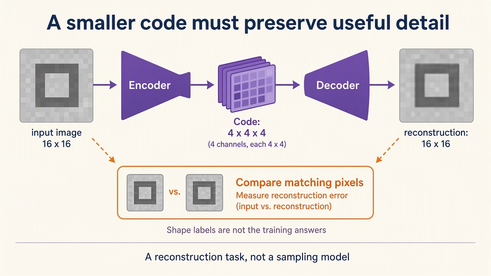

# Rebuilding Through a Smaller Code: Handwritten Theory

## 1. A correct class can discard the very detail rebuilding needs

The CNN only needed to distinguish vertical from horizontal. It could lose
exact location or stroke detail and still choose the right class.
Now ask it to rebuild the image. A class score is no longer enough.

Keep the locally generated sixteen-by-sixteen grayscale setting. Add
diagonals and square rings so the compression task contains more variation.
This is an intentional expansion of the vision example, not a sudden
switch to text.

The dataset carries shape labels for later inspection, but reconstruction
does not use them as checking answers. Each original image supplies its
own target pixels. That separates “what category is this?” from “what
information must survive?”

**Complaint:** copying the input directly would rebuild perfectly without
forcing a compact intermediate representation.

## 2. Make the route pass through a smaller bag

Think of the encoder as packing useful visual evidence into a smaller bag.
Two stride-two convolutions reduce spatial height and width. The final
channel count determines how many feature maps fit inside.

With four channels at four-by-four positions, the latent code holds
sixty-four values per image. It is not a four-class prediction or
a list of four guaranteed human concepts.

The latent code is an **activation for one image**, not stored model
parameters. Encoder weights define how to pack; decoder weights define
how to read the packed result. New images create new codes without
creating new sets of trainable weights.

The decoder learns an expansion back to the original shape. Transposed
convolution is learned upsampling, not the mathematical inverse of the
encoder. Lost detail does not automatically reappear because sizes match.

Sigmoid bounds reconstructed values to the same zero-to-one range as the
images. Correct range and shape establish a comparison contract, not useful
reconstruction.

**Complaint:** an untrained packer and unpacker can satisfy every shape check
while rebuilding badly.

## 3. Let pixel misses teach both ends

Compare each reconstructed pixel with the input pixel at the same coordinate.
Square the misses and average over images, channels, rows, and columns.
That scalar reconstruction error sends feedback through the decoder and
the encoder.

The loader's shape label is deliberately ignored. The model is not learning
an orientation answer, and changing labels alone would not change this
reconstruction objective.

First measure an all-black reconstruction. Sparse shapes have much dark
background, so an apparently small average error can arise from doing almost
nothing. This crude baseline makes the quality question concrete.

Then practise with the explicit clear, guess, measure, backward, step routine.
Record training error and held-out pixel error. The notebook checks that
training improves and honestly reports whether validation beats black.
It does not invent a guaranteed error ranking.

**Complaint:** an average over many pixels can hide a missing stroke or a
filled-in ring.

## 4. Look at paired outputs on the same brightness scale

Place each held-out original directly above its reconstruction.
Keep both display ranges fixed. Automatic contrast adjustment could make
a weak output look sharper than its values justify.

Inference mode avoids recording another backward graph. This model's
convolutions, ReLUs, and sigmoid have no train/eval difference; adding
dropout or batch normalization would also require explicit eval mode.
Skipping a graph and selecting layer behavior remain separate jobs.

Inspect orientation, location, thickness, and the ring's empty center.
The paired images are actual model outputs, not illustrative reconstructions
drawn to support a story. Per-image errors let a visually weak example
remain visible beside the overall mean.

A blurry reconstruction may still achieve low error when most pixels are
background. Conversely, preserving a visible shape does not imply perfect
pixel recovery. The plot and the numeric objective answer related but
different questions.

**Complaint:** even useful rebuilding does not say how much information was
packed or what individual code coordinates mean.

## 5. Count values before claiming compression

One input image contains 256 grayscale values. A four-channel four-by-four
code contains 64, so the stored-value ratio is four to one.

That is not automatically a compressed-file ratio. The precision of values,
the decoder's weights, headers, and the cost of shipping a model matter for
a real compression system. The notebook intentionally measures the smaller
claim.

Flattening the code joins its coordinates into one row per image.
The example axis must survive: we are comparing images' whole codes,
not pretending each patch is another image.

For inspection, average codes within each known shape label and compare
the group centers. Labels organize the audit; they never enter the encoder
or the training loss.

Separated group centers do not prove that one channel means “diagonal”
or that every individual example is separable. Distances also depend on
coordinate scale. Useful evidence can be distributed across many coordinates
without human-readable names.

**Complaint:** perhaps a different bag size balances preservation and
storage better.

## 6. Compare budgets without silently changing the exam

Train fresh two-channel and four-channel models using the same data,
seed recipe, optimizer settings, and eighteen-epoch budget.
Their codes contain 32 and 64 values respectively.

Against 256 input values, those are 8:1 and 4:1 value-count ratios.
The optional eight-channel trial would hold 128 values, a 2:1 ratio.
All three decoders still return 256 pixel values; changing code width
changes the intermediate budget, not the output image size.

A different width necessarily changes parameter shapes and random draws.
Fairness here means a controlled training recipe, not identical initial
arrays for architectures that have different-sized arrays.

The main reconstruction model trained longer. Comparing its final error
with a shorter width trial would confound width with update budget.
Only compare the matched trials as the width experiment.

Report validation error and stored-value ratio together. More room may
help, but optimization, initialization, and budget can change the ordering.
A wider code is not entitled to win.

Once those validation errors help choose width, they are selection
evidence. They aren't an untouched final report on the chosen system.
A new final quality claim would need another check beyond this small
local split.

The nearby drill lets you add one width. Do not change epochs, learning
rate, and code width together, then attribute the result to compression.

## 7. Know which learning problem you did not solve

This ordinary autoencoder does not learn a distributional latent objective.
It has not established that random codes produce valid new shapes.
A variational autoencoder requires that extra objective and sampling evidence;
the names encoder and decoder do not grant it.

Likewise, a compact image code does not remember earlier frames or words.
The [sequence-memory route](../../../03-language-model-foundations/01-sequence-memory/README.md)
adds ordered state while reusing modules, named axes, losses, and updates.

Watch for labels leaking into reconstruction inputs, flattened examples
becoming mixed together, value counts advertised as byte compression,
and group averages advertised as named latent concepts.

**Remember:** a useful code earns its name by preserving measured information
for a declared rebuilding job, not merely by being small.
