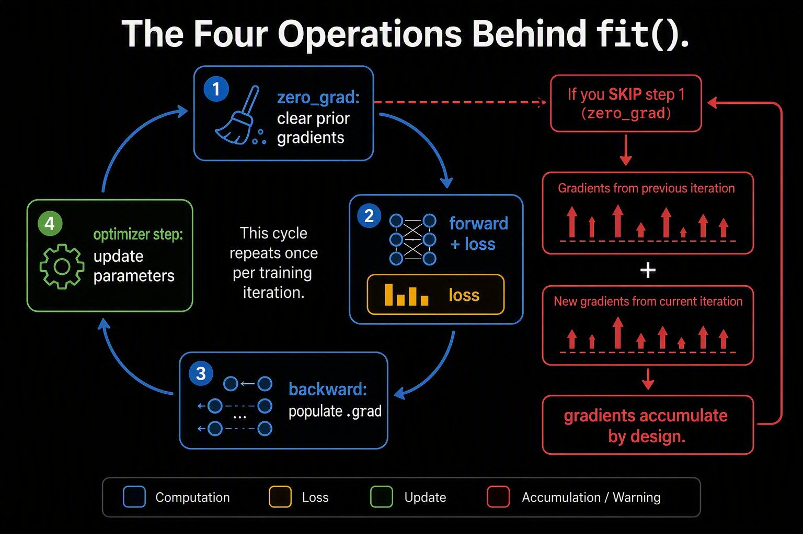

# The Training Skeleton: Handwritten Theory

## 1. Put the jobs back in working memory

You remember neural networks, but a small PyTorch script still has several
owners: the examples, the guesser, the checking rule, and the worker allowed to
change weights. Confusing those owners creates bugs that a successful forward
pass will not expose.

Keep a deliberately small task: two standardized sensor readings describe a
calm or alert cluster. Eight hand-written examples make every label inspectable.
These are not physical measurements, a real alarm, or evidence of safety.

The shortcut asks whether a reusable routine can fit those practice cards.
It does not test validation, devices, scheduling, or checkpoint recovery.
Skipping those experiments does not make their responsibilities disappear.

**Complaint:** even eight correct pairs can become wrong training evidence if
their delivery separates a measurement from its answer.

## 2. A Dataset is the cabinet; a DataLoader is the trolley

Bind each two-feature input row to one integer category ID. A Dataset answers
“what is example i?” A DataLoader answers “which examples arrive together,
and in what order?”

Shuffling changes row delivery, not the sensor columns and not the labels'
partners. The supplied loader brings four examples at a time. Each batch
therefore has four rows with two features, alongside four integer targets.

Those targets are addresses into the two possible class columns, not
one-hot vectors or floating-point measurements. Classification and regression
use different target contracts even when their input tables look alike.

Think of each pair as a sealed envelope. The trolley may rearrange envelopes;
it may not pour the inputs and targets into two independently shuffled piles.

**Complaint:** delivery policy does not tell us who owns the adjustable
guesser. A trolley is not a model.

## 3. A module is an equipment case, not a training command

The first layer turns two measurements into eight hidden features. ReLU bends
those features; the final layer mixes them into two raw class scores.
The batch axis survives each step.

Hidden features are useful intermediate calculations, not eight new examples
or eight class guesses. They need not have names chosen by the lesson.

The model stores 42 parameters: sixteen input-layer weights, eight biases,
sixteen output-layer weights, and two output biases. A four-row batch
produces 32 hidden activations. Those values belong to this forward call;
they aren't 32 new trainable knobs.

The module's initializer builds and registers the layers. Its forward method
describes one prediction using their current parameters. Calling the model
does not compare against labels or quietly improve the weights.

Parameter registration gives the optimizer a discoverable list and makes
state ownership explicit. Call the module itself rather than bypassing its
normal call machinery through a direct forward call.

**Complaint:** correctly shaped scores can still enter the wrong checking
rule. We need to distinguish raw scores from probabilities.

## 4. Loss measures the guess; it does not turn the knobs

The last two columns are logits: unrestricted raw scores for calm and alert.
Cross-entropy compares that score row with the correct integer class ID.
It owns the stable conversion needed to calculate its loss.

Do not apply softmax first and then feed probabilities as if they were new
logits. The tensor shape would remain acceptable while the objective changed.
For choosing a class, the largest raw score already gives the decision.

The loss compresses many example-level mistakes into one scalar. That single
number is convenient feedback, not a complete description of every failure.
A good average can hide an individual bad guess.

The optimizer is another owner. Adam keeps update-related running state in
addition to the model's parameters. That worker's memory is not part of the
forward formula.

Clearing gradients removes old feedback, not learned weights or Adam's
running summaries. Predictions, gradients, parameters, and updater memory
can all contain floating-point numbers while doing different jobs.

**Complaint:** one scalar says how the guesses performed, but we still need
a visible sequence that requests feedback and acts on it.

## 5. Clear, guess, check, trace, adjust

Remember the five jobs rather than memorizing an incantation:

| Job | What changes |
|---|---|
| Clear gradients | Old feedback is removed |
| Forward | New predictions are calculated |
| Loss | Predictions are compared with checking answers |
| Backward | Parameter-gradient buffers receive feedback |
| Step | Parameters change according to the optimizer |

Backward does not update weights. Gradients accumulate unless cleared, which
can be useful deliberately but changes this routine when forgotten.

An epoch is one pass over the loader. Here eight examples in batches of four
mean two updates per epoch. Elsewhere an epoch may contain many more updates.

Eighty epochs in the supplied call therefore make 160 updates. Each
history value summarizes losses seen while parameters changed within an
epoch, not an extra end-of-epoch evaluation of fixed weights.

The reusable fit function receives its model, loader, loss, and optimizer.
Defining it does not train anything; calling it starts the practice.

**Complaint:** a correct update loop can still report an unfair average.

## 6. Average examples, then stop practising to make predictions

A mean batch loss gives every example inside that batch equal weight.
But averaging several batch means equally overweights a smaller final batch.
Recover each batch's total contribution by multiplying its mean by its row
count, add those totals, then divide by all examples.

The supplied eight-row task has equal batches, but the reusable routine keeps
the correct policy for uneven groups too. Recorded training losses describe
the batches as their weights changed, not a separate final evaluation.

After training, evaluation mode selects prediction-time behavior for layers
such as dropout. Inference mode separately avoids building a gradient graph.
Neither call erases the learned weights.

The notebook measures a complete fit on its eight supplied points and checks
that inference creates no gradient-tracking result. That certifies this tiny
practice run, not performance on new sensor readings.

**Complaint:** changing numeric features into words adds preparation and
forward computation, but need it replace the routine?

## 7. Carry the jobs to words, not the eight-row conclusion

In a later word guesser, token IDs fetch embedding rows, context features
combine, and a projection makes vocabulary scores. The target remains an
integer class address, now naming the correct word instead of an alarm state.
The same clear/guess/check/backward/step responsibilities remain.

The refresher's mapping is a shape bridge, not a trained language experiment.
The full chapters still own named axes, held-out evidence, saved state, and
conditional accelerator behavior.

Watch for independently shuffled labels, probabilities passed to the wrong
loss, backward mistaken for an update, unfair batch averages, and training
accuracy presented as generalization.

**Next complaint:** independent rows have no memory of previous rows.
[Sequence Memory](../../03-language-model-foundations/01-sequence-memory/README.md)
adds ordered state without discarding the routine.

**Remember:** delivery brings pairs, the model guesses, loss measures,
backward reports, and the optimizer acts.
