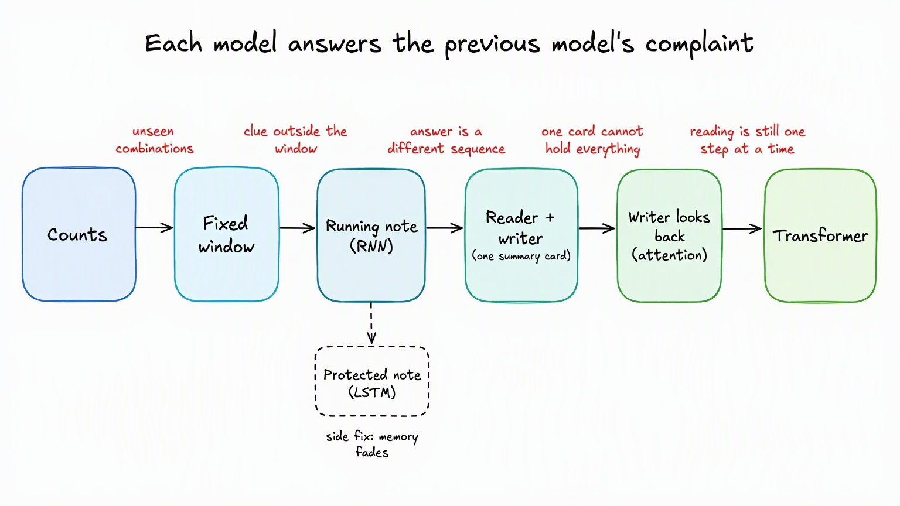

# Chapter 03: Language Models - From Learned Rows to Attention

**Contents:** [one-line map of this directory](CONTENTS.md)

You can fetch a word's embedding row. You can train a network. Now put those skills together:
**what should we ask the model to guess, and what does it need to see to get the answer right?**

[Chapter 02](../02-tokenization-and-embeddings/README.md) explains pieces, IDs, and embedding
rows. Its 02A and 02B lessons stay unchanged. Here we make practice questions from text, train
the rows along with the predictor, and find the limits of each model. That gives us a reason
to want the attention and position machinery in [Stage 04](../../04-transformers/README.md).

The former 02C and all three model-evolution lessons are here in full, with their experiments,
exercises, pictures, and theory notes. The LSTM example and shared-loop demonstrations build
on them rather than replacing them.

We keep the legal phrases for 03A. Then we switch to eight color-clue sentences: you can see
exactly which word decides the answer and whether the model gets to read it. Those sentences
stay the same in 03C. In 03D, reversing digits gives the reader and writer separate jobs and
lets us check exactly where each answer digit came from.

## A few pictures to keep in your head

- **Rows you fetch:** a token ID is an address. The embedding row is the numbers stored there,
  not a little dictionary definition.
- **Seats that keep order:** a fixed window puts retrieved rows in separate positions.
  Averaging those rows loses the seat numbers.
- **A note you carry:** recurrence updates a hidden-state vector after each token. Unlike a
  stored word row, the note depends on what has been read so far.
- **A reader and a writer:** the encoder reads; the decoder writes. The final note handed over
  is the **summary card**. Attention lets the writer consult the earlier saved notes too.

These pictures explain different jobs, not different kinds of intelligence. The actual rows,
notes, and queries are all vectors of numbers learned through training.

## Reader route

| Read | What you can explain afterward | Handwritten notes | Code-only view |
|---|---|---|---|
| [03A. Training skeleton and word objectives](03A-training-skeleton-and-word-objectives.ipynb) | How CBOW and Skip-gram train rows jointly with a predictor, and how the same loop handles a sequence-shaped answer | [Theory](03A-training-skeleton-and-word-objectives-theory.md) | [Python](03A-training-skeleton-and-word-objectives.py) |
| [03B. Counts and fixed windows](03B-counts-and-fixed-window-language-models.ipynb) | Why identical windows force identical predictions, even with learned ordered features | [Theory](03B-counts-and-fixed-window-language-models-theory.md) | [Python](03B-counts-and-fixed-window-language-models.py) |
| [03C. Fixed windows to recurrent language models](03C-fixed-windows-to-recurrent-language-models.ipynb) | How RNN/LSTM state carries history, shifted targets train next-token prediction, and embeddings learn through the inherited loop | [Theory](03C-fixed-windows-to-recurrent-language-models-theory.md) | [Python](03C-fixed-windows-to-recurrent-language-models.py) |
| [03D. Recurrent reader/writer to attention](03D-recurrent-encoder-decoder-to-attention.ipynb) | Why one learned card differs from looking back, and generation needs its own test | [Theory](03D-recurrent-encoder-decoder-to-attention-theory.md) | [Python](03D-recurrent-encoder-decoder-to-attention.py) |

### Why 03A still contains an encoder-decoder

It's a quick peek at where we're going: ask for several answer words and see whether the same
training loop still works. You don't need to master that architecture yet.
Read 03B and 03C next. In 03D, slow down the reader/writer handoff and test whether looking back
helps. You won't need to return to Chapter 02 to find the architecture lesson.

### Find the code without the notebook narration

Want just the code? Each notebook has a `.py` file with the same name and short `# %%` sections.
These are ordinary Python files, not scripts that secretly load the notebooks. You get the
experiments, plots, things to change, and checks without the lesson prose.
Run any one on its own in the chapter environment:

```powershell
.\.venv\Scripts\python.exe .\03C-fixed-windows-to-recurrent-language-models.py
```

Plots use the selected Matplotlib backend. For noninteractive execution, set `MPLBACKEND=Agg`;
the notebooks remain the intended view for inline plots and HTML animations.

The shared [TrainableLanguageModel](language_model.py) keeps the practice routine in one place:
`fit_language_model` runs the loop, `training_loss` calculates the loss, and `targets_for_loss`
selects the answers to grade. 03A shows that small class inline so you can read it; its Python
companion imports the matching version. The added RNN/LSTM model in 03C and reader/writer wrapper
in 03D import it too. The original comparison experiments keep their own sampling and clipping
loops. The wrapper shows another way to connect the model, not a replacement experiment.

```text
TrainableLanguageModel.fit_language_model
-> self.training_loss
-> subclass forward -> model-specific logits
-> subclass/default targets_for_loss
-> cross-entropy -> backward -> optimizer step
```

Keep the guessing jobs separate: CBOW fills a gap, an LSTM continues a stream,
and an encoder-decoder writes an answer based on a separate source.

## The route is not a leaderboard


*A route of complaints, not a ranking of newer models.*


This is a learning route, not a family tree. LSTM gives the running note more control over
what to keep; you don't have to pass through LSTM to use attention. Attention also existed
before Transformers. "Encoder" and "decoder" name the reading and writing jobs, not a particular
layer. CBOW and Skip-gram help us watch word rows learn; they aren't compulsory ancestors of
a Transformer. Convolutional sequence models offer another route, which we leave for later.

## Prerequisites and setup

Use [Stage 02](../../02-pytorch-foundations/README.md) for tensors and optimization.
Use [sequence memory](../01-sequence-memory/README.md) for running notes and LSTM gates.
[Tokenization and embeddings](../02-tokenization-and-embeddings/README.md) explains token
pieces, addresses, and learned rows. Each notebook briefly reminds you of what it needs.
Before 03D, revisit the reader/writer preview in
[03A](03A-training-skeleton-and-word-objectives.ipynb) if the source/target distinction is unclear.

Run `./setup.ps1` in PowerShell or `bash setup.sh` on Linux/macOS from this directory.
The scripts are adapted from sequence-memory. They create a local `.venv`, install
[requirements](requirements.txt), and assign kernel `stage03-language-model-03-models`, displayed
as `Python (Stage 03 Chapter 03 Language Models .venv)`. Python 3.10+ is required.
Select that kernel, restart, and Run All for each notebook independently.
No downloaded models, data, checkpoints, internet calls, or shared notebook state are needed.
The model-evolution experiments use one CPU thread and small tensors to keep runs bounded.

The saved notebooks have no outputs. Run them and read what actually happened; the takeaways
follow the measured results. We show the data splits and different weight counts so the
comparisons don't promise more than they tested. Reversal uses new sequences at familiar lengths,
not longer sequences than the models saw in training. Static pictures and plots keep the lesson
readable even when HTML animations aren't available.

## Try one change at a time

Predict whether `visible_words = 4` reveals color in 03B, then change only that variable.
Explain why revealing a clue is not fitting a four-word model. In 03C, change only
`clue_word`. In 03D, change only the first source digit and compare free-running output
with its expected reversal.

## Handoff

Keeping a better note isn't the whole answer. The writer needs access to earlier notes,
and the recurrent reader still works one token at a time. Continue to the self-contained
[Stage 04 route](../../04-transformers/README.md):
**what if we drop recurrence and let attention do all the reading?**
