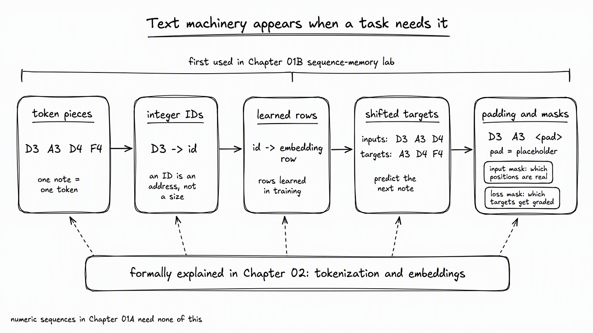

# Stage 03: Language-Model Foundations

**Contents:** [one-line map of this directory](CONTENTS.md)


This stage changes the shape of the problem. The PyTorch loop is now familiar; the new complaints
are memory across a sequence and useful representations for discrete tokens.

## Required route

1. [Sequence Memory](01-sequence-memory/README.md)
2. [Tokenization and Embeddings](02-tokenization-and-embeddings/README.md)

## Recommended reader route

1. [Stage 02 — PyTorch Foundations](../02-pytorch-foundations/README.md) gives you the tensor, batch, and training-loop contracts used throughout this stage.
2. [Chapter 01 — Sequence Memory](01-sequence-memory/README.md) first studies recurrence on numeric sequences, so memory has a clear job before text machinery appears.
3. [Chapter 02 — Tokenization and Embeddings](02-tokenization-and-embeddings/README.md) formally explains the token pieces, integer addresses, learned rows, and padding that Chapter 01B previews.
4. [Counts and Fixed-Window Language Models](model-evolution/01-counts-and-fixed-window-language-models.ipynb) · [theory notes](model-evolution/01-counts-and-fixed-window-language-models-theory.md) starts text prediction with simple counts, then shows what a bounded window cannot see.
5. [Fixed Windows to Recurrent Language Models](model-evolution/02-fixed-windows-to-recurrent-language-models.ipynb) · [theory notes](model-evolution/02-fixed-windows-to-recurrent-language-models-theory.md) reuses the already-familiar recurrent memory to predict text without teaching recurrence twice.
6. [02C — One Training Skeleton, Three Language Objectives](02-tokenization-and-embeddings/02C-context-windows-to-static-embeddings.ipynb) · [theory notes](02-tokenization-and-embeddings/02C-context-windows-to-static-embeddings-theory.md) distinguishes static word-vector objectives from a model that reads one sequence and writes another. You can focus on that task change; CBOW and Skip-gram are not gates for attention.
7. [Recurrent Encoder-Decoder to Attention](model-evolution/03-recurrent-encoder-decoder-to-attention.ipynb) · [theory notes](model-evolution/03-recurrent-encoder-decoder-to-attention-theory.md) asks what changes when the writer can look back at the reader's notes for each source position.
8. [Stage 04 — Transformers](../04-transformers/README.md) remains the canonical route for attention, position, and complete Transformer mechanisms.

The [model-evolution route README](model-evolution/README.md) collects the three new, bounded comparisons and explains their handoffs. The [optional embedding-history branch](optional/embedding-history/README.md) is adjacent background, not a prerequisite for attention.


*where token pieces, IDs, learned rows, padding, shifted targets, and masks first become necessary along the Stage 03 route.*


## Preview, Then Formalize

Chapter 01 uses integer token IDs, padding, shifted targets, and causal checks so recurrence can be
measured in a language-shaped task. Treat those as preview contracts, not as the tokenization
lesson. Chapter 02 then explains where IDs come from and separates the jobs of padding, loss, and
causal masks before reusing the same shapes.

```text
Chapter 01: use the sequence contract to study memory
-> Chapter 02: explain and test the token representation contract
-> Stage 04: replace the recurrent bottleneck with attention and position
```

## Optional branch

- [Embedding History](optional/embedding-history/README.md)

**Previous:** [Stage 02 — PyTorch Foundations](../02-pytorch-foundations/README.md)  
**Current:** Stage 03 — Language-Model Foundations  
**Next:** [Stage 04 — Transformers](../04-transformers/README.md)
