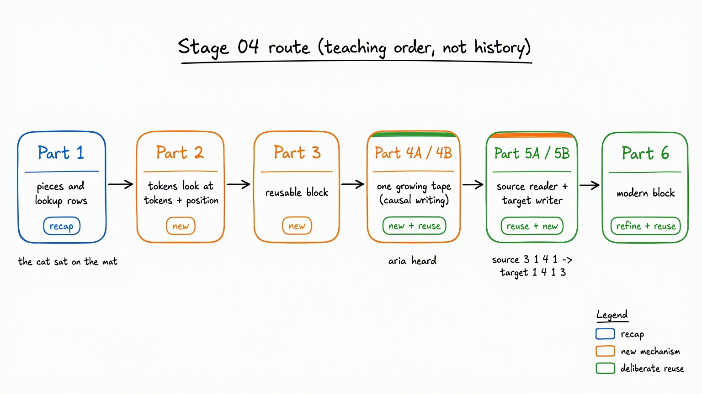
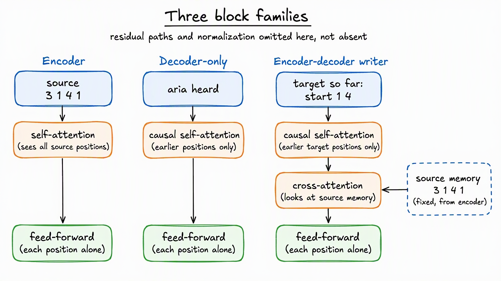

# Stage 04: Transformers

**Contents:** [one-line map of this directory](CONTENTS.md)

**Previous:** [Stage 03 · Language-Model Foundations](../03-language-model-foundations/README.md)

**Current:** Stage 04 · Transformers

**Next:** [Stage 05 · LLM Training](../05-llm-training/README.md)

This track follows one idea all the way through a Transformer: turn text into token IDs, turn IDs into vectors, expose the need for position, let attention exchange information, let feed-forward layers refine each token, turn final vectors into vocabulary scores, and use prediction error to improve every learned step.

The first chapters use small sentences such as `the cat sat on the mat` because the mechanism should be understandable without a fictional business wrapper. Later chapters use the repository's local text corpus only when real data artifacts are necessary to build and train a small base model.

## Reader map: what changes in each Part

**Coming from Stage 03:** If you already know how one component reads a source and another writes a target, the [model-evolution route](../03-language-model-foundations/03-language-models/README.md) is your bridge into this track. Keep those reader/writer roles; Part 5 opens their insides and replaces recurrent updates with Transformer blocks. Standalone readers still get the complete explanation here.

| Part | The question it answers | Familiarity signpost |
|---|---|---|
| 1 | How does `cat` become a reusable piece, an ID, and a trainable row? | **Recap** of Stage 03 foundations; standalone readers start here. |
| 2 | How can `cat` retrieve useful information and distinguish position? | **New mechanism:** attention and position; embedding rows are deliberate reuse. |
| 3 | How do several lookups and private token refinements become one trainable block? | **New mechanism:** complete block; attention is deliberate reuse. |
| 4A | How can a model practise next-token prediction without reading the answer? | **New mechanism:** future-blind visibility; shifting and training/generation are deliberate reuse. |
| 4B | How do those rules survive batching, generation, and saved attention history? | **Deliberate reuse:** implement and check Part 4A's contracts. |
| 5A | How can a writer look back at a separate source whenever it needs a detail? | **Deliberate reuse:** reader/writer roles; **new mechanism:** Transformer source memory and cross-attention. |
| 5B | Can a learned writer reverse `[3, 1, 4, 1]` without being given its earlier answers? | **Deliberate reuse:** implement and measure Part 5A's source-to-target route. |
| 6 | What changes inside a modern block while next-token prediction stays the same? | **New refinements** plus **deliberate reuse** of Part 2 position and Part 4 generation. |


*You can distinguish familiar foundations from each new Transformer mechanism.*


### History versus why we teach it now

Attention predates Transformers: recurrent reader/writer models already used it to look back at source positions. The original Transformer was encoder-decoder. We teach decoder-only first because one growing sequence makes the visibility rule easier to isolate before adding separate source memory. That is a dependency choice, not a historical timeline. Sequence-to-sequence, or *seq2seq*, names a task family: read one sequence and write another. It is not a synonym for Transformer; recurrent models can perform that task too.

## The Learning Spine

Keep this path in view throughout the track:

```text
text
-> tokens and token IDs
-> token embeddings + position
-> Q/K/V attention: gather useful context
-> feed-forward network: refine each token privately
-> vocabulary logits and probabilities
-> next-token prediction and loss
-> backpropagation updates embeddings, attention, FFNs, and the output head
```

Every chapter zooms in on part of this path, then reconnects it to the whole. Equations appear only after the corresponding information movement is visible in words, shapes, or a measured example.

## Entry Check: Full Route or Shortcut

Before Part 1, choose the route that matches your current memory:

- **Full route:** complete [Stage 02 · PyTorch Foundations](../02-pytorch-foundations/README.md), including the
  [tokenization and embedding bridge](../03-language-model-foundations/README.md).
- **Shortcut route:** run the
  [PyTorch Training Skeleton refresher](../02-pytorch-foundations/quick-refresher/pytorch-training-skeleton.ipynb).
  If its readiness check passes, continue through
  [Stage 03](../03-language-model-foundations/README.md) and return here.

Part 1 keeps a compact Transformer-specific recap so the canonical example and gradient contracts
are available in a fresh kernel. It does not reteach `nn.Module`, `DataLoader`, loss, backward, or
optimizer responsibilities; the refresher is the quick recovery point for those mechanics.

| Part | Artifact | Start with the job | End with the evidence |
|---|---|---|---|
| [1. Token Embeddings to Transformers](01-token-embeddings-to-transformers.ipynb) · [Theory](01-token-embeddings-to-transformers-theory.md) | Carry token IDs and learned vectors into contextual modeling | Pieces, IDs, trainable lookup rows, gradient updates, and the ordering failure | Establishes the substrate every Transformer consumes |
| [2. Attention, Position, and RoPE](02-attention-and-position.ipynb) · [Theory](02-attention-and-position-theory.md) | Let token positions retrieve useful context | Minimal attention, permutation failure, additive position, RoPE, Q/K/V, and scaling | Makes contextual routing and relative position visible before block complexity |
| [3. The Complete Transformer Block](03-complete-transformer-block.ipynb) · [Theory](03-complete-transformer-block-theory.md) | Build one reusable shape-preserving unit | Multi-head attention, FFN, normalization, residuals, logits, loss, and backpropagation | Shared foundation for every Transformer family |
| 4A | [Decoder-Only Theory Notebook](04a-decoder-only-language-model-theory.ipynb) · [Handwritten Theory](04-decoder-only-language-model-theory.md) | Make one growing tape future-blind | Causal objective, shifted labels, three mask jobs, serial generation, temperature/top-k, and cache economics |
| 4B | [Decoder-Only PyTorch Lab](04b-decoder-only-language-model-lab.ipynb) | Implement the Part 4A contracts | `Dataset`/`DataLoader`/collation, loss flattening, generation boundaries, and cache parity |
| 5A | [Encoder-Decoder Theory Notebook](05a-encoder-decoder-and-cross-attention-theory.ipynb) · [Handwritten Theory](05-encoder-decoder-and-cross-attention-theory.md) | Read one sequence and write another | Mean-pooling bottleneck, addressable source memory, cross-attention, exposure bias, and cache roles |
| 5B | [Encoder-Decoder PyTorch Lab](05b-encoder-decoder-and-cross-attention-lab.ipynb) | Make source-to-target routing inspectable | Reversal training, rectangular cross-attention, learned routing, and teacher-forced/free-running evaluation |
| [6. Modern Decoder-Only LLM](06-modern-decoder-only-llm.ipynb) · [Theory](06-modern-decoder-only-llm-theory.md) | Keep next-token prediction but improve the block | RMSNorm, RoPE, grouped-query attention, and SwiGLU | Better training and inference trade-offs at current LLM scale |

## Architecture Choice in One View

| Family | What it does | How information moves | Ideal when |
|---|---|---|---|
| Encoder-only | Produces contextual representations of a complete input | Every input token can read every other input token | Classification, tagging, extraction, and retrieval embeddings |
| Decoder-only | Predicts and appends the next token | Each token can read only the prefix to its left | Continuation, chat, code generation, and general autoregressive tasks |
| Encoder-decoder | Reads a source, then generates a separate target | A bidirectional reader builds source memory; a causal writer queries it with cross-attention | Translation, summarization, and source-to-target transformation |

### What is inside each block family?

Self-attention means looking among positions in the same stream. Causal means a writing position cannot look into its future. Cross-attention means the writer looks into a separate source memory. A feed-forward network (FFN) then refines each position privately.

| Block family | Main operations in order | Where it can look |
|---|---|---|
| Encoder | Self-attention, then FFN | All valid positions in the available source. |
| Decoder-only | Causal self-attention, then FFN | The current position and earlier positions on one growing tape. |
| Encoder-decoder writer | Causal self-attention, cross-attention, then FFN | Earlier target context first; separate source memory next. |

This table isolates the information-moving steps. The residual paths that carry earlier states onward and normalization steps that control their scale remain part of the full blocks taught below; they are not removed.


*The writer with a separate source has one extra place to look: cross-attention.*


Run `setup.ps1` on Windows or `setup.sh` on Linux/macOS. Either script creates or reuses this stage's `.venv`, installs the adjacent `requirements.txt`, registers the stage-unique `learning-04-transformers` Jupyter kernel, and assigns it to every notebook in this directory. Every notebook starts in a fresh kernel.

Stage 04 ends with a complete modern decoder-only architecture. Continue to
[Stage 05 · LLM Training](../05-llm-training/README.md) to build its pretraining data contract,
train from random weights, and package resumable evidence.

## One Required Bounded Intervention per Chapter

Each row is one intervention, not a worksheet. Predict first; change only the named variable; run
the named notebook section; measure the stated output; diagnose the mechanism; then write one
sentence saying whether that evidence supports the bounded claim.

| Chapter | Runnable section and one-variable test | Bounded claim to judge |
|---|---|---|
| 1 | [`01-token-embeddings-to-transformers.ipynb`](01-token-embeddings-to-transformers.ipynb), **“Chapter 1 Checkpoint”**: replace only `cat`/`mat` with `dog`/`rug`; measure gradient-bearing rows and the swapped-order mean | lookup rows receive local gradients, while mean pooling still loses order |
| 2 | [`02-attention-and-position.ipynb`](02-attention-and-position.ipynb), **“Chapter 2 Checkpoint”**: change only the minimal-attention query from `cat` to `mat`; measure the strongest non-self route | changing the query changes contextual routing |
| 3 | [`03-complete-transformer-block.ipynb`](03-complete-transformer-block.ipynb), **“Chapter 3 Checkpoint”**: change only `NUM_HEADS` from `4` to `2`; measure head width and score-table shape | head count repartitions a fixed model width |
| 4 | [`04b-decoder-only-language-model-lab.ipynb`](04b-decoder-only-language-model-lab.ipynb), **“Part 4B scorecard”**: change only `top_k` from `3` to `2`; measure the removed candidate | top-k changes the allowed sampling set, not learned weights |
| 5 | [`05b-encoder-decoder-and-cross-attention-lab.ipynb`](05b-encoder-decoder-and-cross-attention-lab.ipynb), **“Part 5B scorecard”**: change only `SOURCE_LENGTH` from `4` to `5`; measure cross-attention shape | source length changes the addressable memory axis |
| 6 | [`06-modern-decoder-only-llm.ipynb`](06-modern-decoder-only-llm.ipynb), **GQA “Your turn”**: change only `trial_kv_heads` among `1, 2, 4, 8`; measure cache elements | fewer KV heads reduce cache state while query-head count stays fixed |
