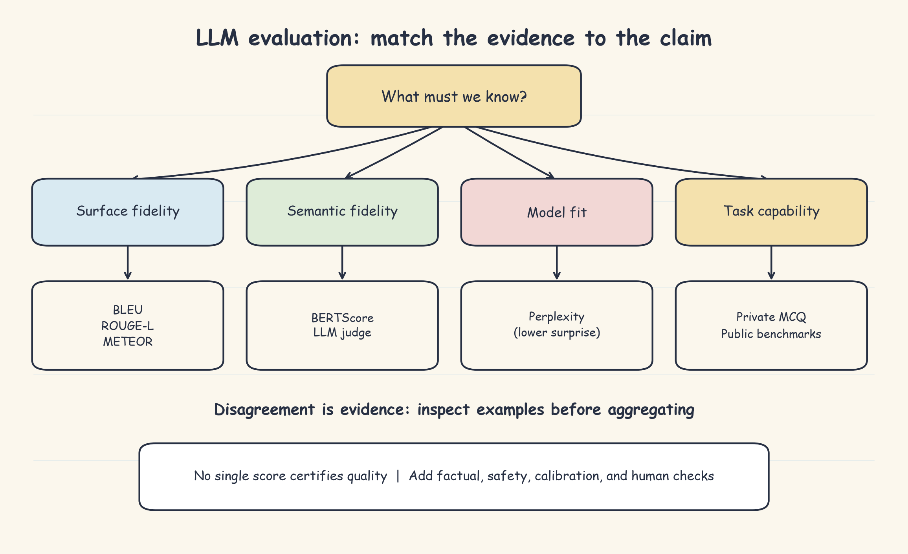
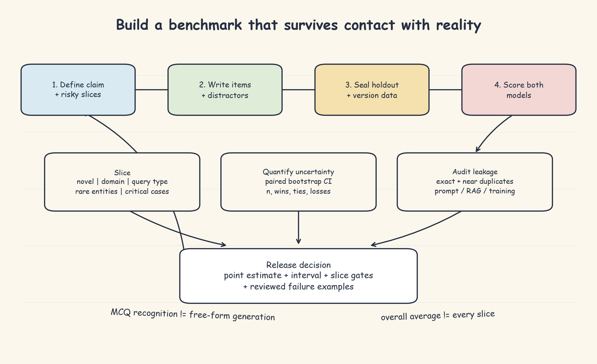

# Evaluating Answers: Same Task, Different Measuring Sticks

Follow the [notebook](01-llm-evaluation-metrics-and-benchmarks.ipynb).
Its [saved CPU run](results/metrics-cpu-smollm2-135m.json) contains the actual answers,
per-case scores and settings. Four visible teaching cases show the mechanics; they
are not a sealed benchmark or proof of general model quality.
The closing [Concept recap](01-llm-evaluation-metrics-and-benchmarks.ipynb#concept-recap)
pairs the core ideas with compact code sketches. Five local illustrations in the
notebook make the matching and surprise mechanisms visible.

## 1. Start with two answers, not a score

Riverside asks why Mei-Lin keeps a pendant. A good answer explains the hidden
letter and family claim, but may use different words from the reference.
Another calls it a valuable heirloom showing her family's status. That sounds
related, but the passage does not support this explanation.

The **reference** is an accepted answer to compare with, not the only correct
way to say it. A **metric** turns a particular check into a number.
Counting familiar words can help, but it does not automatically distinguish
the supported answer from the plausible unsupported one.
Before trusting a score, ask what its rule actually checked.

## 2. Same matching idea, slightly different questions

Suppose the reference says "the pendant hides a letter." Add "small" before
"letter": the central information and ordering survive, although one adjacent
word pair changes. That small change motivates several related views.

| Choice | What do we count? | Why use it? | What still goes wrong? |
| --- | --- | --- | --- |
| ROUGE-1 | Individual matching words | A cheap coverage checklist | The same words can express a different claim |
| ROUGE-2 | Matching neighboring word pairs | Notice some phrase order | An innocent inserted word breaks a pair |
| ROUGE-L | Words that match in the same order, allowing gaps | Tolerate insertions while keeping order | Miss synonyms; reward plausible falsehoods |
| ROUGE-S | Ordered matching word pairs, allowing gaps | An older alternative way to tolerate gaps | Needs a stated gap policy; not measured here |

These are related alternatives, not a historical ladder where each replaces the last.
The notebook opens ROUGE-L once. Libraries supply the other practical ROUGE readings.

The matches themselves support three questions:

| Reading | Plain-English question |
| --- | --- |
| Precision | How much of the wording I produced matched? |
| Recall | How much reference wording did I recover? |
| F1 | Did I do reasonably well on both? |

Extra unmatched text hurts precision; omitted reference wording hurts recall.
Neither establishes factual accuracy. Copying an incorrect reference can score perfectly.

**Complaint:** even preserved meaning can use different words.

## 3. Broader changes need different instruments

BLEU, METEOR and BERTScore are not small ROUGE variants.

| Instrument | Problem it tries to fix | What it does | Remaining limitation |
| --- | --- | --- | --- |
| BLEU | Repeated matches or a tiny answer can flatter naive overlap | Caps repeated matches, combines short phrase matches, penalizes very short output | Penalizes many valid paraphrases |
| METEOR | Exact words miss stems and synonyms | Aligns words and related forms; penalizes scattered matches | Word relationships do not prove a claim |
| BERTScore | A fixed synonym list ignores sentence context | Compares learned lists of numbers that depend on the surrounding words | Close wording and entities can still hide a changed fact |

Within BLEU, the variants are much smaller changes:

| Setting | Additional wording pattern checked |
| --- | --- |
| BLEU-1 | Individual words |
| BLEU-2 | Adjacent pairs as well |
| BLEU-3 | Three-word groups as well |
| BLEU-4 | Four-word groups as well |

Longer groups ask for closer wording, not deeper truth. Smoothing handles missing
phrase matches; effective order handles answers shorter than the requested group size.
Those choices must travel with the score.

BERTScore also reports precision, recall and F1 from the same token matches.
Changing which reading you display does not require another evaluator model.
Our earlier hand-mapped word-count cosine is only a toy; the real run uses DistilBERT.

All reference metrics inherit the reference's omissions and wording choices.
One reference is one accepted answer, not the complete set of correct answers.
The [multiple-reference check](01-llm-evaluation-metrics-and-benchmarks.ipynb#multiple-reference-check)
holds the real generated pendant answer fixed and compares one versus two prewritten
accepted wordings. The slight score change is a protocol change, not model improvement.
Choose references before comparing systems rather than writing one to fit a model's output.

## 4. Surprise answers a different question

Perplexity describes how expected the next tokens were to a model.
Lower means less surprise, not more truth.
Do not confuse a probability with the cost derived from it.
In the [one-token check](01-llm-evaluation-metrics-and-benchmarks.ipynb#loss-probability-check),
a chosen correct-token probability of 0.01 gives loss about 4.605 and single-token
perplexity 100. Cross-entropy is not restricted to zero through one.
These are calculated teaching inputs, not extra model measurements.
The notebook's tiny word-pair model gives the wrong award answer lower perplexity
than the valid paraphrase. It counted local patterns, not what the passage established.

In the real run, the question and context are supplied first. We then score the
fixed reference answer, masking the prompt out of the loss. We do not grade
generated answers by how much the model likes its own choices.
Compare this number only under matching text, tokenization and context policies.

To combine examples, add their reference-token losses and divide by their total
token count before converting to perplexity. Averaging the example perplexities
would answer a different question.

**Complaint:** can an easy reference still accompany a bad generated answer?

## 5. The real CPU run makes that failure visible

The notebook checks public Hugging Face weights and earlier saved checkpoints,
then explicitly chooses pinned SmolLM2-135M-Instruct. DistilBERT is a separate
BERTScore evaluator. A selected broken local checkpoint raises an error rather
than silently turning into the public model.

The generated award answer invents *The Lost City of the Ancients* and upgrades
"longlisted" to "won." Its BERTScore F1 is still about 0.808.
That is not 80.8% factual correctness. The reference itself has perplexity about
1.627 because the context makes it predictable, yet generation went elsewhere.

The rights answer changes review before external licensing into review before
translation. Much wording remains, but the policy condition changes.
Keep the answer and evidence beside the score; the biggest number is not the winner.

The saved record retains model/evaluator revisions, prompt, references, package
versions, token counts and all per-case readings. ROUGE/METEOR/BERTScore summaries
are means; corpus BLEU is not mean sentence BLEU.

## 6. Which tools deserve priority today?

| Job | Sensible role for these metrics | What must accompany them? |
| --- | --- | --- |
| Language-model training | Held-out loss and perplexity remain useful | Task behavior, matching tokenizer/context policy |
| Translation | BLEU remains a comparison baseline | Human checks and learned evaluators such as COMET/xCOMET or MetricX |
| Summarization | ROUGE-1/2/L remain cheap wording checks | Coverage and factual-support checks; semantic similarity when useful |
| Open-ended QA | Similarity can locate cases worth reviewing | Task-specific correctness, evidence support and human-calibrated judgments |

METEOR is an older optional comparison, not a modern release gate by itself.
ROUGE-S is lower priority than support checks in this practical route.
COMET/MetricX are explained as alternatives, not downloaded or measured here.
Current [ROUGE documentation](https://github.com/huggingface/evaluate/blob/main/metrics/rouge/README.md),
[translation-evaluation research](https://aclanthology.org/2025.wmt-1.70/) and
[task-specific evaluation guidance](https://developers.openai.com/api/docs/guides/evaluation-best-practices)
support these bounded uses.

## 7. Averages come last

A **slice** is simply a group of similar questions. Keep each group's results
beside the overall accuracy: improving several literary answers cannot cancel a
failed policy question. The notebook's separate six-item table makes that visible;
it is not another model run. Its exercise repairs evaluation item `b5` while leaving
the policy miss in place, so the two effects can be read separately.

An independent evaluation needs reviewed cases, representative coverage, controlled
training/test overlap, repeated comparisons and uncertainty. Our four visible cases
do not supply those guarantees.

**Built and measured:** representative ROUGE-L, the transparent toys, real CPU generation
and the practical library metric suite.
**Explained only:** ROUGE-S, neighboring BLEU settings and translation-specific alternatives.
**Not established:** local-adapter superiority, general factual accuracy or release readiness.

The next complaint is trust: who checks the evaluator?
Continue to [judge controls](02-llm-as-judge-safety-and-pipeline.ipynb),
[claim support](03-hallucination-detection.ipynb) and
[confidence/abstention](04-calibration-and-confidence.ipynb).
