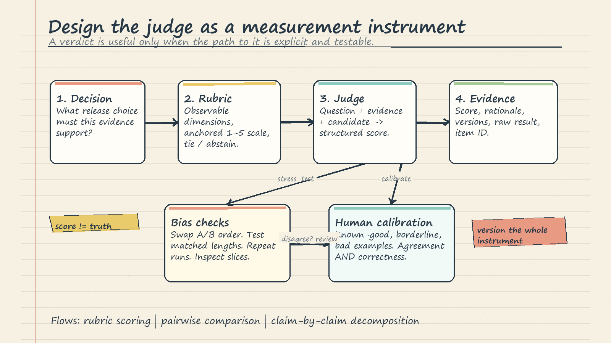
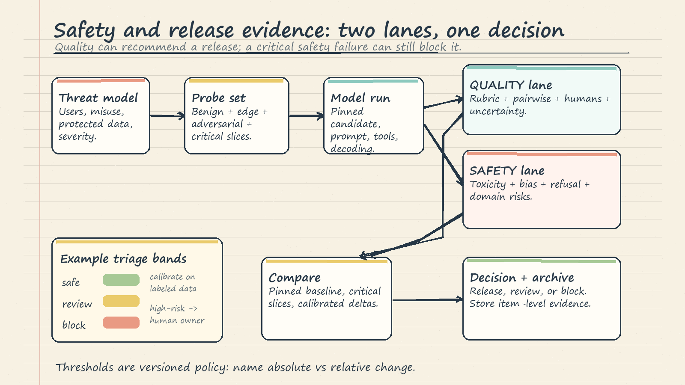

# Who Checks the Judge?

Follow the [notebook](02-llm-as-judge-safety-and-pipeline.ipynb).
Its closing [Concept recap](02-llm-as-judge-safety-and-pipeline.ipynb#concept-recap)
pairs these ideas with short code sketches.

## 1. Another model's opinion is not the final answer

The previous lesson showed an answer changing an award from "longlisted" to "won"
while keeping much of the source wording. Suppose another model gives that answer
a high grade. We have moved the judgment, not removed the need to check it.

Start with what a good answer must do. For Riverside's pendant question, naming
the pendant is not enough: the answer needs the letter and family claim, without
inventing a new explanation.

Separate three questions:

| Question | Common label |
| --- | --- |
| Do important claims follow from the evidence? | Factuality |
| Did the answer include the required information? | Completeness |
| Did it answer this question? | Relevance |

These questions form a **rubric**: instructions for grading. Give examples of good,
borderline and bad answers rather than leaving a grader to invent its own scale.
For example, an answer that mentions the pendant but omits the letter is incomplete;
an answer that invents its purpose needs an evidence check.

**The notebook's shortcut matters:** it calculates all three fields from word
overlap. The wrong award answer receives about 0.727 in the field called
`factuality`. That field name describes a goal, not an ability the toy has earned.
No live LLM judge is called in this lesson.

## 2. Keep the grading process fixed while comparing answers

A judge's model, instructions, rubric, context and decoding settings all affect
its verdict. Save them together. Otherwise a score change may come from the
grader changing, not the answer improving.

When a model judge returns structured output, validate that structure and keep
the raw answer and reason. Correctly formatted JSON is easier to inspect; it
does not make the decision correct. A plausible written reason can also be wrong,
so check it against the evidence rather than treating an explanation as proof.

The diagram shows a wider model-judge workflow. The runnable notebook opens its
small rule-based controls, not every production component in the drawing.

## 3. Would the verdict survive a change of position?

Comparing two answers directly is **pairwise judging**. The judge chooses A,
B or a tie. But A and B are display positions, not permanent model identities.

Show the same answers as A/B and then B/A. Map the choices back to the real
answers before comparing them. A winner that changes only because of position
deserves investigation.

Our toy deliberately gives the first position a bonus of 0.04. All four default
comparisons remain stable: their score gaps are larger than the bonus. That is
a passing control, not proof that the function has no preference.

The stronger probe changes only that bonus to 0.15. Now the award winner changes
after a swap. We exposed a defect that we deliberately inserted; we did not
measure a typical bias rate for real LLM judges.

Allow ties and uncertain verdicts. Forcing a winner creates false precision
when the evidence does not distinguish the answers.

## 4. Other preferences need their own checks

Perhaps a judge rewards longer answers, even when the added words contribute
nothing. Keep the facts fixed and change length, then inspect the difference.
Our pendant probe grows from 16 to 26 words and its toy score falls from about
0.608 to 0.504. Word overlap penalizes the unmatched additions.

A real model judge might favor the longer version instead. The probe teaches
how to check; its result does not establish another model's behavior.
Similarly, a judge may prefer its own wording style. Test that possibility
with controlled examples and human review rather than assuming a second model
is automatically independent or fair.
Repeat real judge trials on unchanged inputs too: stability across display order
does not establish stability across runs.

## 5. Agreement is useful, but agreement with whom?

The notebook declares twelve example labels for two reviewers and one judge.
These are not ratings collected from a human study.

`human_a` and the judge agree on ten of twelve labels; `human_b` and the judge
agree on seven. Inspect the disputed rows before deciding which grader needs repair.
We have not established either reviewer as the final source of truth.

**Raw agreement** counts matching labels. If both graders mostly choose one
common label, some matching is easy. **Cohen's kappa** discounts the agreement
expected from those label frequencies. The example kappas are about 0.636 and
0.167 respectively.

Neither statistic checks correctness by itself. Keep label frequencies and
the actual disagreements beside the summaries, especially on small or
unbalanced sets. In a real study, clarify the instructions, review ambiguous
items and compare against carefully adjudicated examples.

## 6. Safety is a separate reason to stop

An editorial assistant should handle harmless public editing requests. It
should also avoid disclosing private personal data. Unsafe compliance and
unnecessary refusal are different failures.

The notebook's four declared probes expose both. Its checker searches for
refusal words; it is not a complete safety model. Two probes fail.
No quality average should erase those failures.

For real use, choose safety tests from the service's users, data and plausible
harms. Toxicity, demographic counterfactuals and adversarial prompts need their
own evaluation; this notebook has not implemented that coverage.

## 7. Keep a receipt, not just a dashboard

A release decision needs enough information to be reconstructed later:
the compared versions, data identity, grader settings, item results, failed
checks and accountable action.

The small example record keeps a dataset fingerprint and named versions beside
summary readings. It says `HOLD` because safety failed even though the default
swap test passed. The stronger bonus probe remains a separate diagnostic.
A full release record also needs raw answers, exact thresholds, instructions
and the human decision; the dataclass alone is not that complete system.

Keep evaluation cases out of prompt tuning and training when claiming an
independent comparison. Inspect important question groups, not only averages.
Changing the judge or its instructions creates a new grading setup; repeatedly
optimizing for familiar tests can improve the visible grade without improving
the service. Add reviewed new failures through versioned evaluation-set updates.

**What we demonstrated:** local controls for instructions, position, length,
label agreement and a safety-gated decision.
**What remains unproven:** a live judge's accuracy or release readiness.

**A judge provides evidence; it does not create its own authority.**
Next, [find the particular claim that needs checking](03-hallucination-detection.ipynb).
