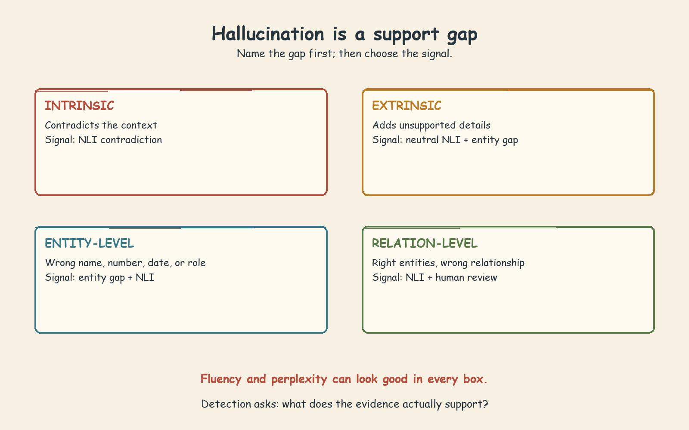
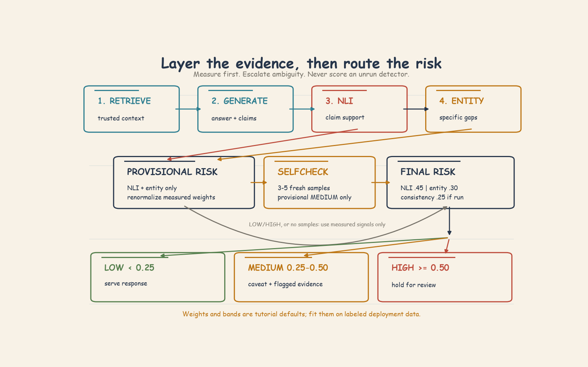

# Which Claim Does the Passage Support?

Follow the [notebook](03-hallucination-detection.ipynb) and its closing
[Concept recap](03-hallucination-detection.ipynb#concept-recap).

## 1. Give the editor a question they can actually check

Our source says Elena Marchetti was **longlisted for the Booker Prize in 2019**.
The practice answer says she **won**, then adds *The Silence of Bridges* as a
novel title. Both sentences contain the person, prize and year.

A whole-answer similarity score can blur the important difference. The editor
needs a more specific task: check the claimed prize outcome and find evidence
for the added title.

A **claim** is something we could check, such as who won or when a book appeared.
Being fluent, detailed or on-topic is not the same as being supported.

## 2. Missing evidence is different from opposing evidence

Use three outcomes for the job we want the evaluator to perform:

| Outcome | What it means |
| --- | --- |
| Supported | The evidence establishes the claim |
| Contradicted | The evidence establishes something incompatible |
| Unknown | The supplied evidence does not settle it |

Being longlisted alone establishes neither winning nor not winning.
The stronger `won` claim is therefore unknown from this passage.
If the evidence explicitly said she did not win, we would have a contradiction.
Likewise, an absent title may be unsupported without being globally nonexistent.

**Grounded** means supported by the evidence supplied here. **True** means it
agrees with the world. A true fact can be absent from retrieval; a faulty source
can support a false statement. A passage-support check and authoritative
world-fact verification are related but different jobs.

## 3. Our first splitter is intentionally too crude

We would like one complete checkable claim per row. The notebook first tries
splitting at full stops, semicolons and `and`.

The award answer remains one piece containing several facts. Elsewhere,
`calculation` becomes a standalone ReAct fragment. These are visible failures
of the splitting rule, not successful extraction of atomic claims.

The following word rules also take shortcuts: chosen word pairs trigger
warnings, and enough shared vocabulary can trigger `supported`.
Those labels are provisional outputs of the toy, not verified evidence
judgments. Even a field called `contradicted` still needs its triggering words
checked in context.

The purpose is to open the workflow and its limits, not claim that punctuation
and shared-word counts solve factuality.

## 4. Familiar names do not verify the relationship

Compare names, years and titles separately from what the answer says happened.
The person, prize and 2019 can all match while `longlisted` changes to `won`.

The notebook's name extractor looks for capitalized word groups and four-digit
years. For the added title it returns `The Silence` and `Bridges`, not one clean
title. It even flags the sentence-opening word `In` elsewhere.
These clues can focus review, but they are not a reliable entity recognizer.

An **entity gap** is a suspected name or detail in the answer that was not found
in the passage. A **relation mismatch** is a changed link between otherwise
familiar entities. Keep both; one cannot replace the other.
The example's `won`/`longlisted` relation row is written for that case rather
than discovered by a general relation model.

## 5. How much review are we willing to do?

The code gives the provisional outcomes chosen risk numbers, adding a small
amount when a name gap appears. These are hand-set ranking scores, not
probabilities that a claim is false.

A threshold decides which rows go to review. Raising it usually reduces
review work but may miss more problems.

| Reading | Question |
| --- | --- |
| Precision | Of the rows flagged, how many carry the problem label? |
| Recall | Of the labeled problems, how many were flagged? |
| Review rate | What fraction of all rows was flagged? |

At the chosen practice threshold 0.2, four of nine fragments are reviewed.
All four have the declared wrong-answer label, yielding precision and recall
of 1.0 on this constructed set.

That result is not a future 100% catch rate. Every fragment inherited its
answer's label; no independent reviewer established claim-level truth.
A real evaluation needs those reviewed labels and new cases.

The exercise increases required recall from 0.80 to 0.90. The selected point
stays unchanged because both require the available 1.0-recall level.
On a tiny discrete set, a stricter target need not change the workload.

## 6. What would a stronger checker add?

A trained **natural-language inference (NLI)** model compares a passage with
a claim and estimates support, contradiction or missing support.
It is a possible replacement for our word rules, not a component run here.
It still needs evaluation on the actual domain and evidence conditions.

The diagram's intrinsic/extrinsic labels distinguish opposing the passage from
adding unsupported details. They are orientation terms, not extra verified
classes produced by our toy.

Repeated-answer consistency is another possible clue: changing stories across
runs suggests instability. Repeating the same wrong answer does not establish
truth. That sampling method is not implemented in this notebook.
Perplexity likewise checks expected wording, not factual support.

## 7. Preserve the review trail

Keep the text being checked, source passage, output label, label origin, score
and reason for review. A reviewer should be able to revisit the actual
evidence, not just accept a risk number.

Before deploying, test the real splitter and checker on independently reviewed
claims, select cutoffs according to missed-problem and review costs, and
evaluate on further untouched cases. Keep an authoritative-source or human
verification path for consequential claims.

**We built a transparent review workflow, not a validated hallucination detector.**
Next, [ask whether a confidence number has a dependable meaning](04-calibration-and-confidence.ipynb).
