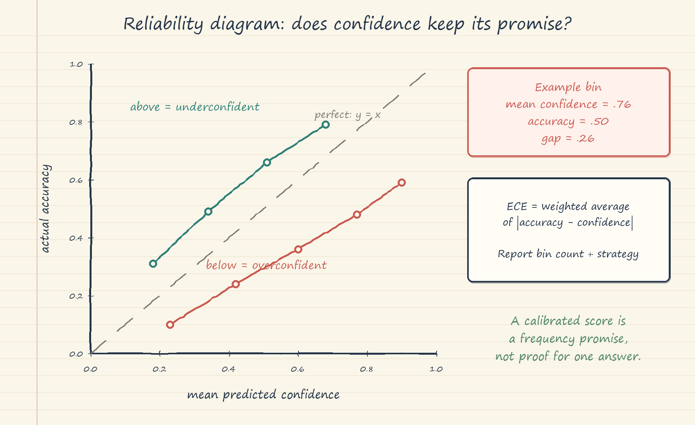
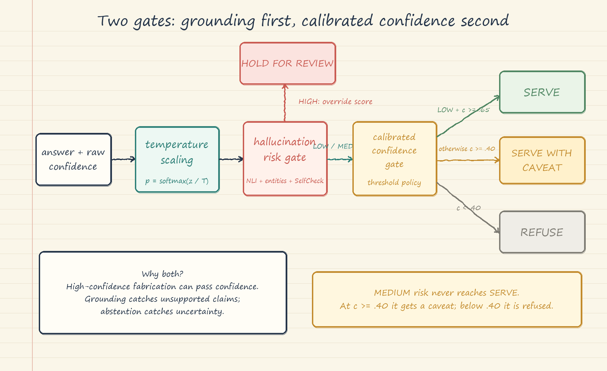

# Does 80% Confidence Mean 80% Right?

Follow the [notebook](04-calibration-and-confidence.ipynb) and its closing
[Concept recap](04-calibration-and-confidence.ipynb#concept-recap).

## 1. A confident answer can still be unsupported

The previous chapter asked what the passage establishes. A separate score now
says "80% confident." That number does not make an unsupported prize claim safe.
It also does not mean that one answer is 80% correct.

Across many comparable answers assigned roughly 80% confidence, we would want
about 80 out of 100 to be correct. Checking that frequency is **calibration**.
Even a well-calibrated group contains errors.

**Accuracy** counts how often the answers were correct. **Confidence** is a
score available before that check. The same answers can have identical
accuracy under very different confidence scores.

The notebook uses twenty declared scores and outcomes. Nine answers are right,
so accuracy is 0.45; mean confidence is about 0.6165.
These are synthetic teaching records, not scores collected from Part 1's model.
We use repeated outcomes because calibration cannot be checked from one sentence.

## 2. Read a group before reading the summary

Group similar confidence scores into **bins**. For each bin, compare mean
confidence with the fraction correct.

Six fixture examples lie between 0.8 and 1.0. Their mean confidence is about
0.892, but only four of six are right. The group is overconfident by about
0.225. It carries weight 6/20 because it contains six of the twenty observations.

**Expected calibration error (ECE)** summarizes the absolute bin gaps while
giving larger groups more weight. The fixture's ECE is about 0.166.
It does not replace the table: it hides where the errors occurred and which
direction each score should move.

The result changes with the bin boundaries. Few broad bins can hide a problem;
many tiny bins can be unstable. A gap measured from six examples is not a
precise population estimate. Keep counts and uncertainty beside the diagram
when making real decisions.

## 3. Try one adjustment, then check whether it helped

**Temperature scaling** uses one positive control to soften or sharpen scores.
A temperature above 1 softens them; below 1 sharpens them; 1 leaves them alone.
The underlying answers do not change.

The notebook converts confidence to log-odds, divides by temperature, then
converts back. It fits that temperature using only the first ten rows and
inspects the second ten afterward.

The fitted temperature is about 2.894. On the second half, ECE increases from
0.164 to about 0.250. **The check got worse.**
We should not claim improvement merely because a parameter was fitted.

The list is sorted: high-confidence rows fit the adjustment, while lower-score
rows test it. Those halves are not representative random samples of the same
score range. This failed refinement shows why calibration data must resemble
the intended use.

The transformation preserves ranking. It cannot move a wrong answer below a
previously lower-ranked correct one. It also cannot establish that the answer
follows from evidence.

## 4. Returning fewer answers has a visible cost

We could decline answers below a cutoff. This is **selective prediction**;
declining is **abstention**.

Keep two measurements:

| Measurement | What it asks |
| --- | --- |
| Coverage | What fraction of requests did we answer? |
| Selective risk | Of the returned answers, what fraction were wrong? |

On the current grid, cutoff 0.50 returns three of ten tuning answers. One is
wrong, so coverage is 0.30 and risk is about 0.333.
Cutoff 0.55 returns none. Coverage becomes zero, while observed risk is
undefined: there were no returned answers to grade.

Do not report that empty set as zero-error success. The code displays `NaN`
and excludes empty returned sets from policy selection.

At the default maximum risk 0.20, no positive-coverage row qualifies.
The selector returns `None` and explicitly says to hold the policy.
That is a finding about this fixture and grid, not every possible threshold.

## 5. Changing the limit does not improve the model

The exercise changes only the ceiling from 0.20 to 0.35. Now the three-returned,
one-wrong row can qualify. We accepted more observed error; we did not repair
the model or create better answers.

Higher thresholds always reduce or preserve coverage. They improve the
remaining accuracy only when score ordering is useful. On real cases, risk
can move unevenly, so read the actual curve rather than assuming every
stricter threshold helps.

We used the second half to explore and choose cutoffs. Despite the code's
`test` variable names, it is therefore decision-tuning data, not a sealed
final evaluation. A real release needs a further untouched check.

## 6. Support and confidence are separate reasons to stop

The final routing table is a different declared illustration. Its confidence
and claim-risk values are not generated or calibrated by the previous cells.
The demonstration uses confidence threshold 0.65 explicitly; it is not the
unavailable sweep-derived policy.

The rules first hold high-risk claims for review. Otherwise, low-risk answers
above the demonstration confidence threshold can be served; other rows get a
caveat or refusal. High confidence does not override high claim risk.

The diagram names possible production support signals, not components
implemented in this fixture. A real service needs independently validated
support checks and calibrated scores under matching model, prompt and data
conditions.

## 7. The gateway must not invent approval

Choose a maximum acceptable risk from the cost of wrong answers, review and
refusal. Validate positive coverage under that rule rather than relaxing it
silently. Check important groups separately so a mean does not hide who is
being refused or harmed.

After a model, prompt or domain changes, reassess calibration and routing.
Do not promote this tiny run: the default sweep found no qualifying nonempty
policy, and the separate router's constants are only examples.

**Confidence needs a frequency check; serving needs both a justified policy and evidence support.**
[Stage 09](../09-llm-gateway/README.md) may enforce approved decisions, not manufacture them.
